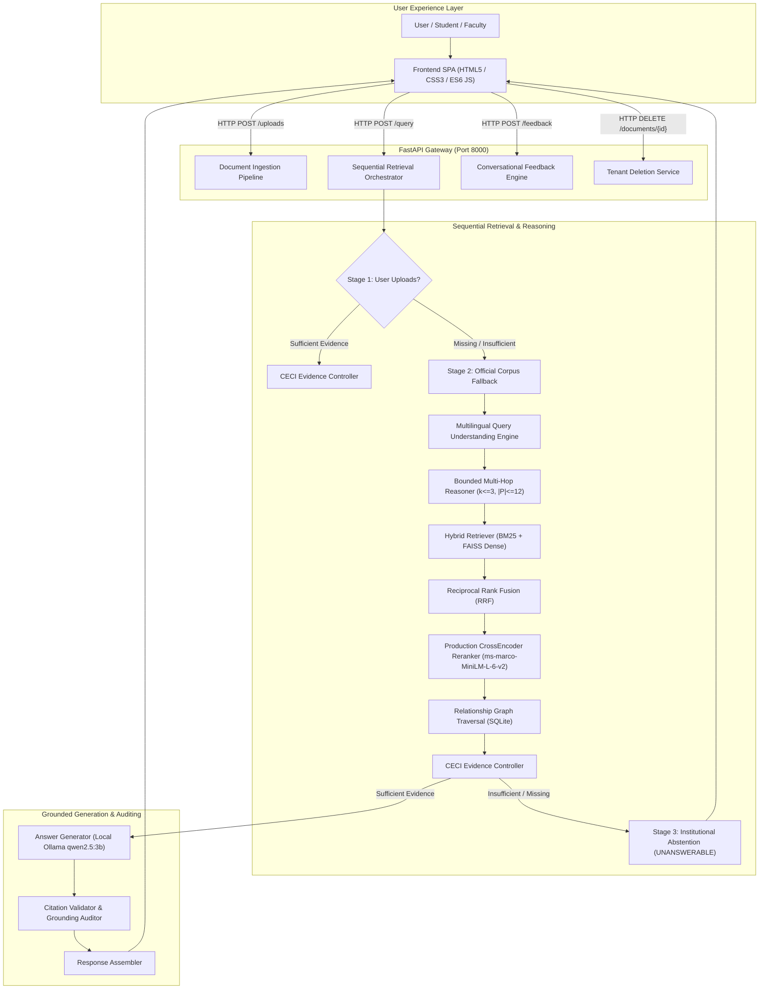

# IndicRAG-QA

**Evidence-Grounded Cross-Lingual Question Answering for Indic and Code-Mixed Languages**

> Academic Regulatory Research Prototype · Final Submission Candidate · Release 1.0  
> Status: **`SUBMISSION_READY`**

---

## 1. Executive Summary & Problem Statement

Academic institutions and universities publish essential student policies, examination schedules, grading criteria, and ordinances across fragmented, semi-structured PDF documents. Students and faculty frequently query these regulations in cross-lingual modes—including English, Hindi (Devanagari), Romanized Hindi, and code-mixed Hinglish.

Standard Retrieval-Augmented Generation (RAG) pipelines fail on academic regulations due to:
1. **Loss of Tabular and Coordinate Structure:** Standard chunking destroys row-column relationships in academic calendars and fee schedules.
2. **Cross-Clause and Regulatory Dependencies:** Regulations frequently condition rules or provide exceptions across different pages or notifications (e.g., standard attendance thresholds conditioned by medical relaxation clauses).
3. **Hallucination & Provenance Gaps:** Large Language Models invent plausible policies when evidence is absent, failing institutional auditability requirements.
4. **Cross-Lingual Misalignment:** Term variations and script mixing lead to retrieval failure or incorrect event selection.

**IndicRAG-QA** solves these challenges by combining:
- **Hierarchical Layout & Tabular Extraction (R1)** preserving cell coordinates and parent-document hierarchies.
- **Typed Relationship Graphs (R2/R3)** storing explicit semantic regulatory links (`CONDITION_FOR`, `EXCEPTION_TO`, `SCHEDULE_FOR`, `SUPERSEDES`).
- **Bounded Multi-Hop Reasoning (R4/R4.1)** with strictly enforced limits ($k \le 3$ hops, $|P| \le 12$ evidence budget).
- **Sequential Fallback Architecture:** User Uploads (Stage 1) $\to$ Authoritative Institutional Corpus (Stage 2) $\to$ Safe Institutional Abstention (Stage 3).
- **Multi-Tenant Security:** Strict isolation ensuring users cannot query or manipulate documents across tenant boundaries.
- **Traceable Citations & Verification:** 100% of asserted factual claims are tied directly to source filenames, pages, and clauses.

---

## 2. High-Level System Architecture



---

## 3. Essential System Features

| Feature | Description | Architecture Milestones |
|:---|:---|:---:|
| **Feature 1: Document Upload & Ingestion** | Full PDF extraction with table grid reconstruction, heading hierarchy, dual BM25/FAISS indexing, status polling, and cascading multi-tenant deletion. | R1, R3 |
| **Feature 2: Document-Aware Sequential Fallback** | Prioritizes user uploads (Stage 1). If missing or insufficient, automatically falls back to official university corpus (Stage 2). If evidence remains missing, triggers institutional abstention (Stage 3). | Architecture Core |
| **Feature 3: Multilingual Query Understanding** | Normalizes and cross-lingually aligns English, Hindi (Devanagari), Romanized Hindi, and Hinglish. Disambiguates calendar events and regulatory terms. | Architecture, R6 |
| **Feature 4: Hybrid Retrieval & Production Reranking** | Merges BM25 lexical precision and FAISS dense semantic embeddings using Reciprocal Rank Fusion (RRF) followed by `ms-marco-MiniLM-L-6-v2` cross-encoder reranking. | R3 |
| **Feature 5: Relationship & Multi-Hop Reasoning** | Traverses typed edges in SQLite with hard computational bounds ($k \le 3$, $|P| \le 12$). Synthesizes multi-condition disclosures and calendar schedules. | R4, R4.1, R4.1.1 |
| **Feature 6: Evidence-Grounded Generation & Abstention** | Local LLM (`qwen2.5:3b`) grounded strictly in retrieved context. Enforces citations `[Filename, Page, Clause]`. Returns deterministic abstention on out-of-corpus queries. | Architecture, R2.1 |
| **Feature 7: Conversational Feedback & Repair** | Multi-turn feedback classifier (`affirmation`, `clarification`, `correction`). Expands context from prior conversation turns and re-evaluates claims. | R5 |
| **Feature 8: Frontend Single-Page Application** | Zero-dependency, responsive web UI mounted directly from FastAPI at root `/`. Supports drag-and-drop PDF upload, document deletion, interactive chat, and clickable citations. | Architecture |

---

## 4. System Requirements

| Component | Specification |
|:---|:---|
| **Operating System** | Windows 10/11, Linux (Ubuntu 20.04+), or macOS |
| **Python** | 3.10, 3.11, or 3.12+ (tested with Python 3.13 via Anaconda) |
| **Local LLM Engine** | [Ollama](https://ollama.com/) (v0.3.0 or later) |
| **Active LLM Model** | `qwen2.5:3b` (installed locally in Ollama) |
| **RAM** | 16 GB minimum recommended |
| **GPU** | Optional (local CPU inference supported out of the box) |

---

## 5. Installation and Setup Guide

### Step 1: Clone Repository
```powershell
git clone https://github.com/Anish-Shrestha/IndicRAG-QA.git
cd IndicRAG-QA
```

### Step 2: Install Python Dependencies
```powershell
cd backend
pip install -r requirements.txt
cd ..
```

### Step 3: Configure Ollama & Local Model
1. Ensure Ollama is running:
   ```powershell
   ollama serve
   ```
2. Verify or pull the required model:
   ```powershell
   ollama pull qwen2.5:3b
   ```

### Step 4: Environment Configuration
Copy `.env.example` to `backend/.env` if not already present:
```powershell
copy backend\.env.example backend\.env
```
Ensure the following key settings:
```ini
OLLAMA_MODEL=qwen2.5:3b
OLLAMA_BASE_URL=http://localhost:11434
ENVIRONMENT=development
```

---

## 6. Running the Application

### Start the Integrated Backend and Frontend
From the project root:
```powershell
python -m uvicorn backend.app.api.main:app --host 0.0.0.0 --port 8000
```
- **Web Application UI:** Open your browser at [http://localhost:8000/](http://localhost:8000/)
- **Interactive Swagger API Docs:** Open [http://localhost:8000/api/docs](http://localhost:8000/api/docs)
- **API Health Check:** Open [http://localhost:8000/health](http://localhost:8000/health)

*(Note: The frontend is a standalone single-page application served directly by FastAPI. Zero Node.js, npm, or Docker build steps are required.)*

---

## 7. Example Queries & Supported Languages

| Query Language | Example Prompt | Expected Grounded Behavior |
|:---|:---|:---|
| **English** | `When do odd semester end semester examinations start and finish?` | Retrieves Academic Calendar Page 4; returns 10-12-2026 to 22-12-2026. |
| **Hindi (Devanagari)** | `विषम सेमेस्टर की अंतिम परीक्षाएं कब शुरू और समाप्त होती हैं?` | Cross-lingually maps query to Odd Semester End Examinations; returns 10-12-2026 to 22-12-2026. |
| **Romanized Hindi** | `Visham semester ki antim pariksha kab shuru aur samapt hoti hai?` | Normalizes Romanized Hindi and extracts correct examination dates. |
| **Code-Mixed Hinglish** | `Odd semester examinations ki start date aur end date kya hai?` | Disambiguates event target and returns Page 4 dates with citations. |
| **Multi-Hop Regulatory** | `Can attendance be relaxed due to medical reasons and what conditions must be satisfied?` | Connects Clause 30.1(v) conditions (two weeks continuous illness, medical certificate, max 10% relaxation). |
| **Upload-Grounded QA** | `What is the mandatory lab rule attendance percentage for Course AI-401?` | Answers exclusively from user-uploaded syllabus/policy PDF (Stage 1). |
| **Safe Abstention** | `What is the university policy regarding operating commercial supersonic drones on campus grounds?` | Safely abstains with institutional notice (UNANSWERABLE). Zero hallucination. |

---

## 8. Verification & Testing

### 1. Run Backend Unit & Integration Tests
```powershell
pytest backend/tests/test_api.py -v
```
*(Verifies 13/13 API endpoints, root UI mounting, upload, status, and cascading deletion.)*

### 2. Run Sequential Fallback Scenarios
```powershell
pytest backend/tests/test_sequential_retrieval_fallback.py -v
```
*(Verifies 9/9 sequential fallback scenarios, tenant isolation, and multi-condition disclosure.)*

### 3. Run R6 Stage 2.1 Multilingual Regression Suite
```powershell
python scripts/test_r6_stage2_1_regression.py
```
*(Verifies 8/8 regression tests including English, Hindi, Hinglish, registration negative tests, and boundary invariants.)*

### 4. Run Final End-to-End Acceptance Suite
```powershell
python scripts/run_final_e2e_acceptance.py
```
*(Executes all 9 full end-to-end tests A through I covering startup, upload, QA, multilingual reasoning, abstention, feedback repair, tenant security, and regression.)*

---

## 9. Project Deliverables & Submission Documentation

Detailed architectural reports, audits, and formal documentation are located in the `docs/` directory:
- [docs/FINAL_PROJECT_ARCHITECTURE.md](docs/FINAL_PROJECT_ARCHITECTURE.md): Complete system architecture, data flows, and schema models.
- [docs/FINAL_IMPLEMENTATION_REPORT.md](docs/FINAL_IMPLEMENTATION_REPORT.md): Complete feature inventory and code modification audit.
- [docs/FINAL_TEST_REPORT.md](docs/FINAL_TEST_REPORT.md): Granular breakdown of unit, smoke, regression, and acceptance test results.
- [docs/FINAL_LIMITATIONS_AND_FUTURE_WORK.md](docs/FINAL_LIMITATIONS_AND_FUTURE_WORK.md): Identified boundaries, trade-offs, and future research directions.
- [docs/PROJECT_FINAL_STATUS.md](docs/PROJECT_FINAL_STATUS.md): Formal sign-off and status declaration (`SUBMISSION_READY`).
- [docs/final_project_architecture_audit.md](docs/final_project_architecture_audit.md): Pre-implementation repository audit and gap analysis.
