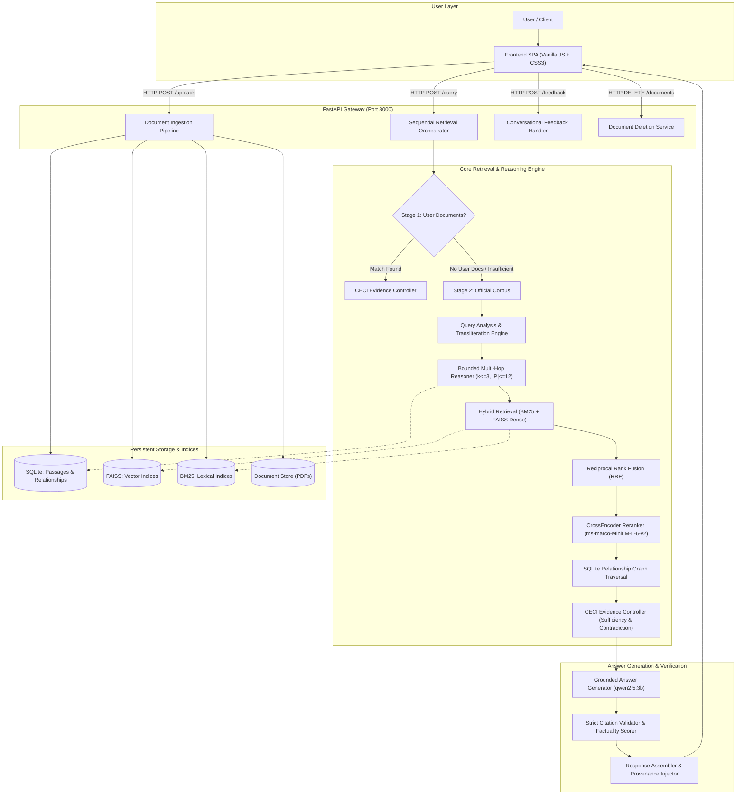

# IndicRAG-QA — Final System Architecture Specification

## 1. System Overview

**IndicRAG-QA** is an evidence-grounded, cross-lingual question answering system engineered specifically for academic and institutional regulatory documents across Indic, Romanized, and code-mixed languages. 

The system enforces strict provenance tracking, parent-document hierarchy, tabular structure preservation, typed regulatory relationship graphs, bounded multi-hop reasoning ($k \le 3, |P| \le 12$), production reranking, and institutional abstention when evidence is insufficient or contradictory.

---

## 2. Core Architecture Pipeline

### 2.1 Feature 1: Document Upload & Ingestion Pipeline
- **Extraction (R1)**: High-fidelity PDF extraction preserving tabular structure, cell coordinates, headings, sections, and parent-child hierarchy.
- **Chunking**: Heading-aware passage chunking maintaining document provenance (`document_id`, `page`, `chunk_id`, `section`, `clause_id`).
- **Generic Relationship Extraction (R3)**: Extracts typed edges (`REFERENCES`, `EXEMPLIFIES`, `SCHEDULE_FOR`, `CONDITION_FOR`, `EXCEPTION_TO`, `SUPERSEDES`) across extracted clauses and table rows.
- **Dual Indexing**:
  - **Lexical Index**: BM25 with Indic term tokenization.
  - **Dense Vector Index**: Sentence-Transformers dense embedding (`all-MiniLM-L6-v2` or `paraphrase-multilingual-MiniLM-L12-v2`) indexed with FAISS.
- **Multi-Tenant Storage**: Documents tagged by `user_id`. Tenant-isolated SQLite tables and isolated FAISS indices ensure total segregation.
- **Lifecycle Management**: Synchronous and asynchronous indexing modes (`wait=True/False`), status tracking (`GET /documents/{document_id}/status`), and cascading deletion (`DELETE /documents/{document_id}`) removing PDF, SQLite records, and vector indices.

### 2.2 Feature 2: Document-Aware Sequential Fallback
The system implements strict institutional fallback logic via `SequentialRetrievalOrchestrator`:
1. **Stage 1 (User Documents)**: If the user has active uploaded documents, the system searches only within the user's isolated document store. If sufficient evidence is found, the answer is grounded solely in the user's uploaded context.
2. **Stage 2 (Official Corpus Fallback)**: If no user documents exist, or if the user uploaded documents contain insufficient evidence, the system safely falls back to the authoritative institutional corpus (Academic Calendars, Ordinances, Notifications).
3. **Stage 3 (Safe Institutional Abstention)**: If neither user uploads nor official corpus provide verifiable evidence, the system explicitly abstains (`status="unanswerable"` or `status="clarification_needed"`), preventing hallucinations.

### 2.3 Feature 3: Multilingual Query Understanding
The query understanding layer handles:
- **Language Detection & Classification**: Distinguishes English, Devanagari Hindi, Romanized Hindi, and Code-Mixed Hinglish.
- **Transliteration & Lexical Expansion**: Translates and expands regulatory vocabulary (e.g., `विषम सेमेस्टर` $\to$ `Odd Semester`, `antim pariksha` $\to$ `end semester examination`, `chhutti` $\to$ `vacation/holiday`).
- **Target Event & Clause Extraction**: Identifies the exact institutional entity (e.g., distinguishing "End-Semester Examinations" on Page 4 from "Make-up Examination Registration" on Page 1 of the Academic Calendar).

### 2.4 Feature 4: Hybrid Retrieval & Production Reranking
- **BM25 Lexical Retrieval**: Accurately matches exact clause identifiers, course codes (e.g., `AI-401`), and regulatory terms.
- **Dense FAISS Retrieval**: Captures semantic intent across cross-lingual expressions.
- **Reciprocal Rank Fusion (RRF)**: Merges lexical and dense rankings using $RRF(d) = \sum_{m} \frac{1}{60 + r_m(d)}$.
- **Production CrossEncoder Reranker**: Employs `cross-encoder/ms-marco-MiniLM-L-6-v2` to score candidate passages against query semantics, filtering out low-scoring distractors before reasoning.

### 2.5 Feature 5: Relationship-Aware & Bounded Multi-Hop Reasoning
- **Graph Traversal**: Explores incoming and outgoing typed edges (`CONDITION_FOR`, `EXCEPTION_TO`, `SUPERSEDES`, `SCHEDULE_FOR`) stored in SQLite.
- **Strict Bounded Complexity**:
  - Maximum Reasoning Traversal Depth: $k \le 3$ hops.
  - Maximum Total Evidence Budget: $|P| \le 12$ passages.
- **Distractor Filtering & Schedule Synthesis**: Filters out non-matching events (such as registration windows when examination dates are requested) and synthesizes multi-condition disclosures (such as standard attendance rules versus medical relaxation clauses).

### 2.6 Feature 6: Evidence-Grounded Answer Generation & Abstention
- **Generator**: Local LLM (`qwen2.5:3b` via Ollama) receiving strict instructions to rely exclusively on supplied context passages.
- **Citation Precision**: Every asserted claim must cite its origin `[DocName, Page P, Clause C]`. Citations are validated by the Citation Validator.
- **Deterministic Abstention**: When evidence sufficiency score falls below threshold or when the query asks about out-of-scope policies (e.g., campus drone regulations), the system returns an explicit abstention notice.

### 2.7 Feature 7: Conversational Feedback & Turn Repair (R5)
- **Feedback Classification**: Classifies user inputs into `direct_query`, `affirmation`, `clarification`, or `correction`.
- **Targeted Turn Repair**: When a user challenges a previous response (e.g., "That is incorrect, please check Clause 30.1(v) for medical exemptions"), the system:
  1. Identifies the repair action (`evidence_expansion`, `re_retrieval`, or `constraint_relaxation`).
  2. Expands the seed evidence with the cited clause.
  3. Re-evaluates evidence through CECI and re-generates an updated, grounded answer.

### 2.8 Feature 8: Frontend Single Page Application
- **Zero-Dependency Architecture**: Built using pure HTML5, modern CSS3, and standard ES6 JavaScript. No Node.js build step or external UI framework needed.
- **Features**:
  - Live API status indicator.
  - Multi-file drag-and-drop document upload with real-time indexing status.
  - Document management modal with file metadata, status badges, and single-click deletion.
  - Interactive chat interface supporting English, Hindi, and Hinglish queries.
  - Interactive citation badges linking answers directly to source pages and clauses.
  - One-click feedback buttons (Thumbs Up / Thumbs Down / Dispute) with automated repair routing.

---

## 3. Storage Schema & Data Models

### 3.1 SQLite Relational Store
- **`documents` Table**: Metadata (`doc_id`, `filename`, `user_id`, `doc_type`, `uploaded_at`, `status`).
- **`passages` Table**: Extracted text units (`passage_id`, `doc_id`, `page_number`, `chunk_index`, `section_heading`, `clause_number`, `content`, `bbox_json`).
- **`relationships` Table**: Graph edges connecting evidence units (`source_passage_id`, `target_passage_id`, `relation_type`, `confidence`, `evidence_text`).

### 3.2 Vector Indices
- **`user_{user_id}.faiss`**: Tenant-isolated FAISS IndexFlatIP index storing normalized dense passage embeddings.
- **`official_corpus.faiss`**: Master FAISS index storing pre-indexed official regulations and academic calendars.

---

## 4. Multi-Tenant Security & Isolation Model

1. **Query Isolation**: All retrieval queries validate `user_id`. Queries for user $U_A$ never search or return candidate vectors or passages belonging to user $U_B$.
2. **Deletion Security**: `DELETE /documents/{document_id}` strictly verifies that `document.user_id == requesting_user_id`. Unauthorized requests receive HTTP 403 Forbidden.
3. **Data Erasure**: Deletion immediately purges raw PDFs from disk, removes associated passage and relationship rows from SQLite, and rebuilds or removes the tenant's vector index.
