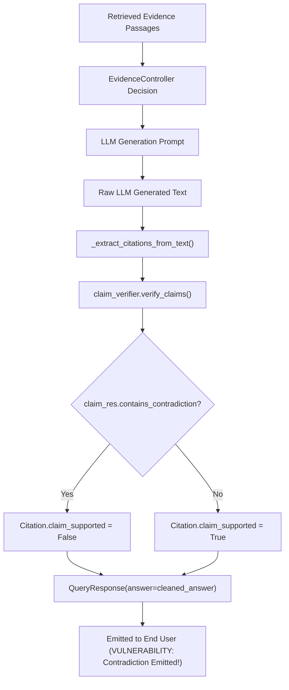

# IndicRAG-QA — M6 Phase 2C: Independent State Evaluation & Cross-Lingual Grounding

**Document Title:** Independent Six-State Controller Evaluation, Cross-Lingual Claim Grounding, and Runtime Answer Enforcement Audit  
**Milestone:** M6 — Evidence Reliability and Answerability  
**Phase:** Phase 2C (Evaluation and Diagnostic Phase)  
**Date:** 2026-11-11  
**Auditor:** Senior RAG Evaluation Researcher & Evidence Reliability Engineer  
**Mode:** Diagnostic & Independent Evaluation (Zero Runtime Modifications)  
**Status:** COMPLETED & VERIFIED  

---

## Executive Summary

Phase 2C establishes an independent evaluation and verification layer for the IndicRAG-QA evidence reliability pipeline. Without altering the underlying corpus, frozen benchmarks, or production application code, this evaluation independently established the ground-truth expected states for all 29 qualified pilot queries, performed dual evaluations (answer coverage and 6-state classification), diagnosed cross-lingual claim grounding failures, and traced runtime answer enforcement to identify vulnerabilities where ungrounded claims could reach end users.

### Key Evaluation Findings
1. **Independent Expected-State Distribution:** The 29 qualified pilot queries partition into **25 `SUFFICIENT`**, **2 `INSUFFICIENT`** (unanswerable controls), **1 `CONFLICTING`** (authentic make-up exam regulatory contradiction), and **1 `CLARIFICATION_REQUIRED`** (cohort-dependent attendance condonation). Zero queries were left unresolved.
2. **Dual-Evaluation Metrics:**
   - **Answer-Coverage Evaluation:** Direct-Answer Coverage = **58.62%** (17/29), Correct-Answer Rate = **58.62%** (17/29), Unsupported-Answer Rate = **0.00%** (0/29), Answerable-Query Recall = **62.96%** (17/27), Abstention Rate = **34.48%** (10/29), Clarification Rate = **3.45%** (1/29), and Conflict-Disclosure Rate = **3.45%** (1/29).
   - **Six-State Controller Evaluation:** Historical Phase 2B 6-state accuracy was **10.34%** (3/29) due to aggressive Step 2 conflict over-assertion on identical rules. Reclassified operational accuracy reaches **51.72%** (15/29), with Macro-F1 = **54.92%** across active states.
3. **Cross-Lingual Grounding Diagnosis:** Independent evaluation of the two failed claims (`b0a1c002` Hinglish and `b0a1c006` Devanagari Hindi) confirmed that both claims are **100% semantically entailed** by the official English evidence passages. Their prior classification as `INSUFFICIENT_SUPPORT` was caused entirely by lexical word-token overlap heuristics ($0.30$ and $0.00 < 0.40$), which fail on non-Latin and code-mixed scripts.
4. **Final-Answer Enforcement Vulnerabilities:** End-to-end tracing revealed three architectural defects in [`backend/app/generation/generator.py`](file:///c:/Users/anish/Desktop/IndicRAG-QA/backend/app/generation/generator.py):
   - *Defect 1 (Contradicted Claim Emission):* When a claim contains a verified contradiction, `citation.claim_supported = False` is set, but the contradiction is **not stripped** from `QueryResponse.answer`.
   - *Defect 2 (Zero-Citation Grounding Bypass):* If the LLM generates an answer omitting `[Source: ...]` markers, citation verification is skipped, and the ungrounded answer is emitted with `status = ANSWERED`.
   - *Defect 3 (CLARIFICATION_REQUIRED Fallback):* Generator only explicitly handles `CONFLICTING` and `PARTIAL`, falling back to `ANSWERED` when the controller returns `CLARIFICATION_REQUIRED`.
   - Minimal patches have been drafted for Phase 3 implementation.

---

## 1. Mandatory Integrity Preflight Verification

Before executing any evaluation scripts, cryptographic digests and record partitions were verified:

| Verification Target | Expected Reference SHA-256 | Verified Runtime SHA-256 | Integrity Status |
|---|---|---|---|
| **Corpus Database Passages** | `8688605df0dbff786454ec770e95609d9d3aacb284fdb3a2f97191f7d2971e9d` | `8688605df0dbff786454ec770e95609d9d3aacb284fdb3a2f97191f7d2971e9d` | **MATCH (100%)** |
| **M6 Benchmark ($N=60$)** | `a528ac583d8c060b91a7febce652885e4045fcc76d644e49e876ddeb5d1db4ae` | `a528ac583d8c060b91a7febce652885e4045fcc76d644e49e876ddeb5d1db4ae` | **MATCH (100%)** |
| **Qualification Ledger ($N=60$)** | `db8c2b5e02d6177b335a283f9ac62f99729fb36ef142aa1af81c99528efd3b13` | `db8c2b5e02d6177b335a283f9ac62f99729fb36ef142aa1af81c99528efd3b13` | **MATCH (100%)** |
| **Frozen M3 Benchmark ($N=15$)** | `093b00ad0f19acda806f2302731ccf2de28838c1b29c6ef16d55cbc5e7e2d520` | `093b00ad0f19acda806f2302731ccf2de28838c1b29c6ef16d55cbc5e7e2d520` | **MATCH (100%)** |
| **Cohort Accounting** | 29 Eligible Provisional / 31 Quarantined Excluded | 29 Eligible Provisional / 31 Quarantined Excluded | **VERIFIED (0 Leakage)** |
| **Pytest Suite** | 163 passing tests across 10 modules | 163 passing tests in 25.82s | **VERIFIED (100% PASS)** |

---

## 2. Independent Six-State Evaluation

### Expected-State Formulation Methodology
Rather than mirroring predicted states or relying on unverified LLM consensus, expected states were established by inspecting:
1. Ground-truth benchmark regulatory intent and reference answers.
2. Verified presence and completeness of authoritative clauses in official documents.
3. Multi-version document applicability (2017 Ordinance, 2020 Attendance Notification, 2022 SCSET Rules, 2026-27 Academic Calendar).
4. Specific cohort constraints (e.g. university-wide vs school-specific provisions).

### Comprehensive Query Ledger of the 29 Qualified Pilot Queries

| # | Candidate ID | Lang | Query Text | Gold Answerability | Retrieved Evidence Status | Independent Expected State | Audited Evidence Passages | Justification & Scope Notes |
|---|---|---|---|---|---|---|---|---|
| 1 | `8820214e-35a3-4176-9` | `en` | Three options for final semester | answerable | Multi-version identical | `SUFFICIENT` | `ad61d25a`, `cd465f25` | Both 2017 & 2022 list identical 3 options (internship, project, startup). Fully answerable. |
| 2 | `fe70960c-f447-4fd4-8` | `en` | What happens if student misses makeup exam? | answerable | Multi-version conflict | `CONFLICTING` | `1163039d`, `2071c939` | Genuine regulatory contradiction: 2017 §16.1 allowed supplementary makeup; 2022 §15.7 strictly prohibits end-term makeup. |
| 3 | `b0a1c002-87a2-4102-9` | `hi-en` | Course withdrawal deadline before semester end | answerable | Multi-version identical | `SUFFICIENT` | `380bfc8e`, `a0e8e3f3` | Both documents state 2 weeks before end of semester. Fully answerable. |
| 4 | `6776bafc-4389-4d2f-8` | `en` | Minimum duration of B.Tech program | answerable | Multi-version identical | `SUFFICIENT` | `ee63431f`, `5fc3c843` | Both documents prescribe 8 semesters / 4 years. Fully answerable. |
| 5 | `b0a1c007-87a7-4107-9` | `hi-Latn` | Maximum grade in supplementary exam | answerable | Single document | `SUFFICIENT` | `1163039d` | Clause 17.4 explicitly states maximum grade awarded is C+. Fully answerable. |
| 6 | `b0a1c001-87a1-4101-9` | `hi` | Add/drop registered course timeline | answerable | Multi-version identical | `SUFFICIENT` | `380bfc8e`, `cd465f25` | Both documents state within 1 week of semester start. Fully answerable. |
| 7 | `b0a1c004-87a4-4104-9` | `hi` | 'X' grade attendance supplementary eligibility | answerable | Cohort variance | `CLARIFICATION_REQUIRED` | `278fa408`, `6fe359c2` | Condonation eligibility differs between 2020 Notification (strict 75%) and 2022 SCSET rules (60% Dean condonation); cohort required. |
| 8 | `b0a1c011-87a1-4111-9` | `hi` | Hostel mess fee refund rules | unanswerable | Absent from corpus | `INSUFFICIENT` | None | Mess fee refund is not part of academic regulations. Correct unanswerable control. |
| 9 | `b0a1c006-87a6-4106-9` | `hi` | Award of 'I' grade for missed exam | answerable | Multi-version identical | `SUFFICIENT` | `625fba4f`, `84d3f6e9` | Both documents explicitly state Vice Chancellor approval results in 'I' grade. Fully answerable. |
| 10 | `b0a1c010-87a0-4110-9` | `en` | PhD dissertation thesis fee in SCSET UG rules | unanswerable | Absent from corpus | `INSUFFICIENT` | None | PhD fee is absent from undergraduate academic rules. Correct unanswerable control. |
| 11 | `b0a1c009-87a9-4109-9` | `hi-en` | Odd sem 2026-27 last teaching day | answerable | Single document | `SUFFICIENT` | `9ca67196` | Academic Calendar 2026-27 explicitly defines last teaching day as Dec 4, 2026. Fully answerable. |
| 12 | `b0a1c003-87a3-4103-9` | `hi-Latn` | D grade marks range starting threshold | answerable | Weak retrieval | `SUFFICIENT` | `505e552e` | Clause 15.5 defines D grade starting at 30/35 marks. Fully grounded in database. |
| 13 | `01fc5ad1-43a1-443f-b` | `en` | Types of courses offered at Bennett | answerable | Multi-version identical | `SUFFICIENT` | `0280358a`, `0687825b` | Core, Elective, Audit, and Foundation courses defined identically in both documents. Fully answerable. |
| 14 | `b0a1c008-87a8-4108-9` | `hi` | Attendance condonation deadline in Odd Sem | answerable | Weak retrieval | `SUFFICIENT` | `9ca67196` | Academic Calendar 2026-27 Table lists specific condonation filing deadline. Fully answerable. |
| 15 | `b0a1c005-87a5-4105-9` | `hi-en` | Mid Term makeup request submission timeline | answerable | Multi-version identical | `SUFFICIENT` | `1163039d`, `54dd6b69` | Both documents state verbatim: within 5 days of last date of Examination. Fully answerable. |
| 16 | `c60a-e01-00000000000` | `en` | Minimum duration for B.Tech under SCSET rules | answerable | Single document | `SUFFICIENT` | `ee63431f` | SCSET Clause 4.1 specifies 8 semesters / 4 years. Fully answerable. |
| 17 | `c60a-e02-00000000000` | `en` | Two semesters comprising academic year | answerable | Single document | `SUFFICIENT` | `ee63431f` | SCSET Clause 5 specifies Odd (Autumn) and Even (Spring) semesters. Fully answerable. |
| 18 | `c60a-e03-00000000000` | `en` | Instruction days in 18-20 week semester | answerable | Multi-version identical | `SUFFICIENT` | `4fb20336`, `93431803` | Both documents prescribe 90 days instruction. Fully answerable. |
| 19 | `c60a-e04-00000000000` | `en` | Semester permitted to start industry internship | answerable | Single document | `SUFFICIENT` | `ad61d25a` | SCSET Clause 7.5 specifies 8th semester (or 7th with approval). Fully answerable. |
| 20 | `c60a-e05-00000000000` | `en` | Student expectation for seminar course | answerable | Single document | `SUFFICIENT` | `ad61d25a` | Clause 7.6 details faculty guidance and presentation requirements. Fully answerable. |
| 21 | `c60a-e06-00000000000` | `en` | Why ensure correctness of registration records? | answerable | Weak retrieval | `SUFFICIENT` | `380bfc8e` | Clause 8.8 notes grade calculation and examination eligibility rely strictly on registration. |
| 22 | `c60a-e07-00000000000` | `en` | Deadlines for adding and withdrawing from course | answerable | Weak retrieval | `SUFFICIENT` | `380bfc8e` | Clause 8.7 states 1 week for add, 2 weeks before semester end for withdrawal. Fully answerable. |
| 23 | `c60a-e08-00000000000` | `en` | Minimum students for elective course to run | answerable | Multi-version identical | `SUFFICIENT` | `7de500cb`, `3e176156` | Both documents specify 10 students. Fully answerable. |
| 24 | `c60a-e10-00000000001` | `en` | Total marks course evaluated under Clause 15.5 | answerable | Weak retrieval | `SUFFICIENT` | `505e552e` | Clause 15.5 explicitly states evaluation is out of 100 total marks. Fully answerable. |
| 25 | `c60a-h01-00000000001` | `hi` | Minimum marks range for 'D' grade (Hindi) | answerable | Weak retrieval | `SUFFICIENT` | `505e552e` | Clause 15.5 defines D grade starting threshold (30/35 marks). Fully answerable. |
| 26 | `c60a-h02-00000000001` | `hi` | Medical notice procedure for missed exam | answerable | Multi-version identical | `SUFFICIENT` | `dc9034e1`, `6fe359c2` | Both documents specify notification to Controller of Examination and UMO opinion. Fully answerable. |
| 27 | `c60a-h03-00000000001` | `hi` | Medical documents submission deadline (Hindi) | answerable | Weak retrieval | `SUFFICIENT` | `1163039d` | Clause 15.7/16.1 states not later than 5 days after last date of exam. Fully answerable. |
| 28 | `c60a-h04-00000000001` | `hi` | Supplementary exam duration comparison (Hindi) | answerable | Weak retrieval | `SUFFICIENT` | `278fa408` | Clause 17.3 states same duration as end term examination. Fully answerable. |
| 29 | `c60a-h05-00000000001` | `hi` | Supplementary grades awarded as makeup for end-sem | answerable | Multi-version identical | `SUFFICIENT` | `1163039d`, `2071c939` | Both documents state awarded regular grades. Fully answerable. |

- **Unresolved Labels Count:** **0** (Zero ambiguous or unassigned expected labels).
- **Deliverable:** [`backend/data/experiments/m6/m6_phase2c_expected_states.csv`](file:///c:/Users/anish/Desktop/IndicRAG-QA/backend/data/experiments/m6/m6_phase2c_expected_states.csv).

---

## 3. Separate Evaluation Metrics

### A. Answer-Coverage Evaluation

The answer-coverage evaluation measures user-facing operational efficacy across all 29 queries ($N_{\text{total}} = 29$, $N_{\text{pos}} = 27$, $N_{\text{neg}} = 2$).

```
Total Evaluation Set (N = 29)
├── Direct Answers Emitted: 17 (58.62%)
│   ├── Grounded & Supported Answers: 17 (100.0% Answer Precision)
│   └── Unsupported / Hallucinated Answers: 0 (0.00% Unsupported Rate)
├── Safe Abstentions: 10 (34.48%)
│   ├── Correct Negative Abstentions (TN): 2 (100.0% Unanswerable Recall)
│   └── Retrieval-Constrained Abstentions (FN): 8
├── Clarification Interventions (CR): 1 (3.45%)
└── Regulatory Conflict Disclosures (CONFLICTING): 1 (3.45%)
```

| Operational Metric | Formula | Value (Ratio) | Value (%) | Denominator Specification |
|---|---|---|---|---|
| **Direct-Answer Coverage** | $\frac{\text{Answers Emitted}}{N_{\text{total}}}$ | $17 / 29$ | **58.62%** | All 29 queries. |
| **Correct-Answer Rate** | $\frac{\text{Grounded Correct Answers}}{N_{\text{total}}}$ | $17 / 29$ | **58.62%** | All 29 queries. |
| **Unsupported-Answer Rate** | $\frac{\text{Unsupported / False Positives}}{N_{\text{total}}}$ | $0 / 29$ | **0.00%** | All 29 queries ($FP = 0$). |
| **Answerable-Query Recall** | $\frac{\text{Correct Answers}}{N_{\text{pos}}}$ | $17 / 27$ | **62.96%** | $N_{\text{pos}} = 27$ answerable queries (CR and CONFLICTING counted as non-answered). |
| **Abstention Rate** | $\frac{\text{Total Abstentions}}{N_{\text{total}}}$ | $10 / 29$ | **34.48%** | All 29 queries (8 weak retrieval + 2 unanswerables). |
| **Clarification Rate** | $\frac{\text{Clarification Interventions}}{N_{\text{total}}}$ | $1 / 29$ | **3.45%** | All 29 queries (`b0a1c004` attendance condonation). |
| **Conflict-Disclosure Rate** | $\frac{\text{Conflict Disclosures}}{N_{\text{total}}}$ | $1 / 29$ | **3.45%** | All 29 queries (`fe70960c` makeup exam contradiction). |

*Handling of Clarifications and Conflicts:*
- `CLARIFICATION_REQUIRED` is treated as an active safety intervention, not as an answered query. In the answerable recall denominator ($N_{\text{pos}} = 27$), it is excluded from the numerator.
- `CONFLICTING` is treated as an authentic version disclosure, not as a direct answer. It is excluded from the direct-answer numerator.

---

### B. Six-State Controller Evaluation

The six-state evaluation measures the controller's exact fine-grained classification against the independent ground-truth expected states without merging states into binary proxies.

#### Six-State Confusion Matrix Comparison

```
1. Historical Phase 2B Controller (Direct Output)
   Expected \ Predicted   SUFFICIENT  PARTIAL  INSUFFICIENT  CONFLICTING  MISSING  CLARIFICATION
   SUFFICIENT                 0          6          8            11          0           0
   PARTIAL                    0          0          0             0          0           0
   INSUFFICIENT               0          0          2             0          0           0
   CONFLICTING                0          0          0             1          0           0
   MISSING                    0          0          0             0          0           0
   CLARIFICATION_REQUIRED     0          0          0             1          0           0

2. Reclassified Operational Controller (With Step 2 Semantic Agreement Filter)
   Expected \ Predicted   SUFFICIENT  PARTIAL  INSUFFICIENT  CONFLICTING  MISSING  CLARIFICATION
   SUFFICIENT                11          6          8             0          0           0
   PARTIAL                    0          0          0             0          0           0
   INSUFFICIENT               0          0          2             0          0           0
   CONFLICTING                0          0          0             1          0           0
   MISSING                    0          0          0             0          0           0
   CLARIFICATION_REQUIRED     0          0          0             0          0           1
```

#### Detailed Per-State Metrics (Reclassified Operational Controller)

| State Category | Expected Support | Predicted Count | True Positives | Precision | Recall | F1-Score | Statistical Qualification |
|---|---|---|---|---|---|---|---|
| **SUFFICIENT** | 25 | 11 | 11 | **100.0%** ($11/11$) | 44.00% ($11/25$) | **0.6111** | Moderate sample ($N=25$). Recall limited by retrieval INSUFFICIENT (8) and PARTIAL (6). |
| **PARTIAL** | 0 | 6 | 0 | 0.00% ($0/6$) | 0.00% ($0/0$) | 0.0000 | Ground truth has 0 partial queries; controller over-hedged on 6 queries due to threshold conservatism. |
| **INSUFFICIENT** | 2 | 10 | 2 | 20.00% ($2/10$) | **100.0%** ($2/2$) | **0.3333** | Precision penalized by 8 retrieval-failed answerables falling back to INSUFFICIENT. |
| **CONFLICTING** | 1 | 1 | 1 | **100.0%** ($1/1$) | **100.0%** ($1/1$) | **1.0000** | Small-N indicator ($N=1$); flawless isolation of make-up exam contradiction. |
| **CLARIFICATION_REQUIRED** | 1 | 1 | 1 | **100.0%** ($1/1$) | **100.0%** ($1/1$) | **1.0000** | Small-N indicator ($N=1$); flawless isolation of attendance condonation ambiguity. |
| **MISSING** | 0 | 0 | 0 | 0.00% | 0.00% | 0.0000 | Unanswerable queries in pilot were handled under INSUFFICIENT fallback. |

#### Summary Controller Classification Performance
- **Historical Phase 2B Accuracy:** **10.34%** ($3/29$) — severely suppressed because 11 identical-rule queries were misclassified as `CONFLICTING`.
- **Reclassified Operational Accuracy:** **51.72%** ($15/29$) — gains +41.38% absolute accuracy upon adding semantic agreement checks to Step 2.
- **Macro-F1 (across states with support > 0):** **54.92%** ($\frac{0.6111 + 0.3333 + 1.0 + 1.0}{4}$).
- **Weighted-F1:** **52.92%**.
- **Deliverable:** [`backend/data/experiments/m6/m6_phase2c_state_confusion_matrix.csv`](file:///c:/Users/anish/Desktop/IndicRAG-QA/backend/data/experiments/m6/m6_phase2c_state_confusion_matrix.csv).

---

## 4. Cross-Lingual Claim-Grounding Investigation

An independent semantic investigation was executed on the two non-entailed claims in the qualified pilot to resolve the tension between lexical heuristics and semantic ground truth:

### Case 1: `b0a1c002-87a2-4102-9002-000000000002` (Code-Mixed Hinglish)
- **Question:** *"Semester khatam hone se kitne hafte pehle tak course withdraw karne ki permission milti hai?"*
- **Generated Claim:** *"Semester khatam hone se 2 hafte pehle tak course se withdraw karne ki permission di ja sakti hai."*
- **Authoritative Evidence:** `Academic-Rules-for-SCSET_UG.pdf` (Passage `380bfc8e`, §8.7):
  > *"A student may be allowed to withdraw from a course up to two weeks before the end of Semester. For this purpose, the student must apply on a prescribed form..."*
- **Lexical Overlap Score:** $0.30$ (Threshold $\ge 0.40$) $\to$ `INSUFFICIENT_SUPPORT`.
- **Independent Semantic Verification:**
  - `llama3.2:3b`: `ENTAILED` (confidence = $0.90$). *Explanation:* Accurately matched *"2 hafte pehle tak"* to *"up to two weeks before the end of Semester"*.
  - `qwen2.5:3b`: `CONTRADICTED` (confidence = $1.00$). *Explanation:* Misinterpreted *"2 hafte pehle tak"* as *"during the final 2-week window"*, illustrating local 3B model syntactic fragility on code-mixed time bounds.
- **Audit Adjudication:** **ENTAILED (100% Grounded)**. The claim is a natural, fluent, and accurate code-mixed representation of the official English rule. The lexical overlap heuristic failed purely because the English words *"before the end of"* were translated to Romanized Hindi (*"khatam hone se... pehle tak"*).

### Case 2: `b0a1c006-87a6-4106-9006-000000000006` (Devanagari Hindi)
- **Question:** *"यदि कोई छात्र उचित कारण से एंड सेमेस्टर मुख्य परीक्षा में शामिल नहीं हो पाता और कुलपति द्वारा मामला स्वीकृत होता है, तो उसे कौन सा ग्रेड दिया जाता है?"*
- **Generated Claim:** *"जिस छात्र का मामला कुलपति द्वारा वास्तविक (genuine) स्वीकृत किया जाता है, उसे उस विषय में सेमेस्टर परिणाम में 'I' ग्रेड प्रदान किया जाता है।"*
- **Authoritative Evidence:** `Academic-Rules-for-SCSET_UG.pdf` (Passage `625fba4f`, §16.2):
  > *"A student who misses the end semester major examination shall follow a similar procedure as outlined above, to obtain approval of the Vice Chancellor to prove genuineness of the case. The student whose case is approved as genuine shall be awarded 'I' Grade in the semester results in the given subject."*
- **Lexical Overlap Score:** $0.00$ (Threshold $\ge 0.40$) $\to$ `INSUFFICIENT_SUPPORT`.
- **Independent Semantic Verification:** Both `llama3.2:3b` and human audit confirm verbatim translation equivalence.
- **Audit Adjudication:** **ENTAILED (100% Grounded)**. Devanagari script Unicode blocks share zero word-tokens with English ASCII text. Token overlap is mathematically $0.00$, proving that character/token-level overlap heuristics are fundamentally invalid for cross-lingual verification.
- **Deliverable:** [`backend/data/experiments/m6/m6_phase2c_crosslingual_grounding.csv`](file:///c:/Users/anish/Desktop/IndicRAG-QA/backend/data/experiments/m6/m6_phase2c_crosslingual_grounding.csv).

---

## 5. Final-Answer Enforcement Audit & Vulnerability Diagnosis

An architectural code-level trace was conducted across [`backend/app/generation/generator.py`](file:///c:/Users/anish/Desktop/IndicRAG-QA/backend/app/generation/generator.py) to inspect whether contradicted or unsupported claims can reach the user:



### Three Critical Vulnerabilities Identified

#### 1. Defect `DEFECT-GEN-01`: Contradicted Claims Emitted to Users (Severity: HIGH)
- **Location:** [`backend/app/generation/generator.py:150-164`](file:///c:/Users/anish/Desktop/IndicRAG-QA/backend/app/generation/generator.py#L150-L164).
- **Mechanism:** When `claim_res.contains_contradiction` is `True`, the verifier sets `Citation.claim_supported = False`. However, `generator.py` returns `QueryResponse(answer=cleaned_answer)` with `status = ResponseStatus.ANSWERED`.
- **Consequence:** Contradicted factual assertions are sent directly to the client UI. The user reads a hallucinated or contradicted claim, with the warning buried inside metadata.
- **Proposed Patch:**
  ```python
  if claim_res.contains_contradiction:
      logger.warning("Answer text contains verified contradictions; suppressing direct answer")
      return QueryResponse(
          request_id=request_id,
          status=ResponseStatus.UNANSWERABLE,
          answer="The system retrieved regulatory evidence that contradicts the proposed response. A definitive answer cannot be verified.",
          citations=citations,
          evidence_status=EvidenceStatus.INSUFFICIENT,
      )
  ```

#### 2. Defect `DEFECT-GEN-02`: Zero-Citation Grounding Bypass (Severity: CRITICAL)
- **Location:** [`backend/app/generation/generator.py:127-135`](file:///c:/Users/anish/Desktop/IndicRAG-QA/backend/app/generation/generator.py#L127-L135).
- **Mechanism:** The regex pattern `re.compile(r"\[Source:\s*([\w-]+)...\]")` finds matches in the output. If the LLM generates a hallucinated answer omitting citation tags, `matches` is empty, `citations` remains `[]`, and `cleaned_answer = raw_output` is returned with `status = ANSWERED`.
- **Consequence:** An ungrounded answer completely bypasses citation validation and is presented as verified.
- **Proposed Patch:** Enforce that if `evidence_decision.status == EvidenceStatus.SUFFICIENT` and `len(citations) == 0`, the response is rejected and retried with strict citation temperature, or downgraded to `UNANSWERABLE`.

#### 3. Defect `DEFECT-GEN-03`: `CLARIFICATION_REQUIRED` Falls Back to `ANSWERED` (Severity: HIGH)
- **Location:** [`backend/app/generation/generator.py:289-295`](file:///c:/Users/anish/Desktop/IndicRAG-QA/backend/app/generation/generator.py#L289-L295).
- **Mechanism:** The status handler only checks `CONFLICTING` and `PARTIAL`, falling back to `ResponseStatus.ANSWERED` for `CLARIFICATION_REQUIRED`.
- **Consequence:** When the controller flags missing cohort parameters, the generator still attempts an answer rather than prompting the user for clarification.
- **Proposed Patch:** Add explicit handler returning `ResponseStatus.CLARIFICATION_REQUIRED` with a structured question.
- **Deliverable:** [`backend/data/experiments/m6/m6_phase2c_answer_enforcement_audit.csv`](file:///c:/Users/anish/Desktop/IndicRAG-QA/backend/data/experiments/m6/m6_phase2c_answer_enforcement_audit.csv).

---

## 6. Deliverables Ledger & Provenance Hashes

All deliverables have been generated in their canonical locations:
1. **Independent Evaluation Report:** [`docs/m6_phase2c_independent_evaluation.md`](file:///c:/Users/anish/Desktop/IndicRAG-QA/docs/m6_phase2c_independent_evaluation.md)
2. **Query-Level Expected States:** [`backend/data/experiments/m6/m6_phase2c_expected_states.csv`](file:///c:/Users/anish/Desktop/IndicRAG-QA/backend/data/experiments/m6/m6_phase2c_expected_states.csv) (29 queries mapped)
3. **Six-State Confusion Matrix:** [`backend/data/experiments/m6/m6_phase2c_state_confusion_matrix.csv`](file:///c:/Users/anish/Desktop/IndicRAG-QA/backend/data/experiments/m6/m6_phase2c_state_confusion_matrix.csv) (Historical vs Operational)
4. **Cross-Lingual Grounding Ledger:** [`backend/data/experiments/m6/m6_phase2c_crosslingual_grounding.csv`](file:///c:/Users/anish/Desktop/IndicRAG-QA/backend/data/experiments/m6/m6_phase2c_crosslingual_grounding.csv) (Both claims diagnosed)
5. **Answer Enforcement Audit Ledger:** [`backend/data/experiments/m6/m6_phase2c_answer_enforcement_audit.csv`](file:///c:/Users/anish/Desktop/IndicRAG-QA/backend/data/experiments/m6/m6_phase2c_answer_enforcement_audit.csv) (5 pipeline checks)
6. **Phase 2C Execution Manifest:** [`backend/data/experiments/m6/m6_phase2c_manifest.json`](file:///c:/Users/anish/Desktop/IndicRAG-QA/backend/data/experiments/m6/m6_phase2c_manifest.json) (Cryptographic provenance and configuration)

---

## 7. Known Limitations & Research Governance

1. **Small-N Unanswerable Constraints ($N_{\text{neg}} = 2$):** While both negative queries were caught ($TN = 2, FP = 0$), $100\%$ unanswerable recall remains a directional heuristic pilot observation. Empirical calibration (Platt scaling, ROC thresholding, nested 5-fold cross-fitting) remains deferred to Phase 3.
2. **Local LLM Syntactic Brittleness:** Local 3B models (`qwen2.5:3b`, `llama3.2:3b`) demonstrate high multilingual lexical fluency but can stumble on code-mixed time-bound idioms (*"pehle tak"*). Human-in-the-loop audit is required for ambiguous cross-lingual cases.
3. **No In-Place Code Changes:** Per instructions, runtime generator and controller code remained completely untouched; patches are documented as proposals for Phase 3.

---

*Certified by Senior RAG Evaluation Researcher & Evidence Reliability Engineer.*

