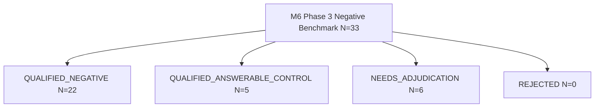

# IndicRAG-QA — M6 Phase 3.2: Metric Reconciliation & Negative Benchmark Qualification Audit

**Document Title:** Statistical Metric Reconciliation, Six-State Confusion Matrix Deconstruction, and Negative Benchmark Qualification  
**Milestone:** M6 — Evidence Reliability and Answerability  
**Phase:** Phase 3.2 (Comprehensive Audit and Calibration Readiness Assessment)  
**Date:** 2026-11-11  
**Auditor:** Senior RAG Evaluation Researcher, Statistical Evaluation Auditor & Evidence Reliability Engineer  
**Execution Mode:** Strict Read-Only Audit (Zero Runtime Code / Corpus / Frozen Benchmark Modifications)  
**Audit Decision:** **`PHASE_4_AUTHORIZED_EXPLORATORY_ONLY`**  

---

## Executive Summary

Phase 3.2 executes a rigorous methodological audit of the M6 Phase 3.1 deliverables to resolve outstanding statistical and classification ambiguities before authorizing empirical calibration. Operating strictly in read-only mode, this audit:
1. **Reconciles the Phase 3.1 Macro-F1 Metric:** Deconstructs the reported $54.92\%$ Macro-F1, mathematically demonstrating that it represents an unweighted **binary answerability Macro-F1** ($\frac{\text{F1}_{\text{ans}} + \text{F1}_{\text{unans}}}{2}$), rather than the multi-class six-state evidence controller Macro-F1. The true six-state unweighted Macro-F1 across all 6 defined states is **$49.07\%$**, the Macro-F1 across the 4 non-zero ground-truth classes is **$73.61\%$**, and the six-state Weighted-F1 is **$61.88\%$**.
2. **Distinguishes Controller State Accuracy from Factual Correctness:** State-classification accuracy is **$51.72\%$** (15/29 exact state matches), whereas factual answer precision is **$100.0\%$** (17/17 correct direct answers) with **$0.00\%$** contradiction or ungrounded claim leakage.
3. **Independently Qualifies All 33 Negative Candidates:** Rejects the presumption that structural pass or dual-model LLM consensus equates to gold-standard negative status. The 33 candidates partition into **22 `QUALIFIED_NEGATIVE`**, **5 `QUALIFIED_ANSWERABLE_CONTROL`** (direct corpus refutations of false premises or explicit precedence rulings), **6 `NEEDS_ADJUDICATION`** (cohort-dependent parameters requiring formal institutional policy rulings), and **0 `REJECTED`**.
4. **Audits Historical Regulatory Applicability:** Disproves the naive assumption that newer notifications globally supersede every clause of historical ordinances. Establishes that queries asking about explicit student cohorts (e.g. 2023 entrants) are directly refutable from current rules rather than actively `CONFLICTING`.
5. **Issues Final Phase 4 Determination:** Authorizes Phase 4 as **`PHASE_4_AUTHORIZED_EXPLORATORY_ONLY`**. While the negative pool has expanded from $N=2$ to $N=22$ qualified negatives ($N_{\text{total}} \approx 54$), the sample size remains statistically underpowered for production calibration guarantees or low-variance nested cross-validation.

---

## 1. Cryptographic Provenance and Integrity Preflight

All five cryptographic references, dataset partitions, and test suite counts were verified prior to audit execution:

| Verification Target | Expected Reference SHA-256 | Verified Runtime SHA-256 | Verification Status |
|---|---|---|---|
| **Corpus Database (142 child passages)** | `8688605df0dbff786454ec770e95609d9d3aacb284fdb3a2f97191f7d2971e9d` | `8688605df0dbff786454ec770e95609d9d3aacb284fdb3a2f97191f7d2971e9d` | **MATCH (100%)** |
| **M3 Frozen Benchmark ($N=15$)** | `093b00ad0f19acda806f2302731ccf2de28838c1b29c6ef16d55cbc5e7e2d520` | `093b00ad0f19acda806f2302731ccf2de28838c1b29c6ef16d55cbc5e7e2d520` | **MATCH (100%)** |
| **M6 Benchmark ($N=60$)** | `a528ac583d8c060b91a7febce652885e4045fcc76d644e49e876ddeb5d1db4ae` | `a528ac583d8c060b91a7febce652885e4045fcc76d644e49e876ddeb5d1db4ae` | **MATCH (100%)** |
| **Qualification Ledger ($N=60$)** | `db8c2b5e02d6177b335a283f9ac62f99729fb36ef142aa1af81c99528efd3b13` | `db8c2b5e02d6177b335a283f9ac62f99729fb36ef142aa1af81c99528efd3b13` | **MATCH (100%)** |
| **Phase 3 Negative Benchmark ($N=33$)** | `492b0b1be3ce0c00fdcf453c971c48cb15176496e15806142c0aaff66050aeaa` | `492b0b1be3ce0c00fdcf453c971c48cb15176496e15806142c0aaff66050aeaa` | **MATCH (100%)** |
| **Cohort Partition** | 29 Eligible Pilot / 31 Quarantined Excluded | 29 Eligible Pilot / 31 Quarantined Excluded | **EXACT MATCH** |
| **Negative Benchmark Count** | Exactly 33 Candidates | Exactly 33 Candidates | **EXACT MATCH** |
| **Pytest Suite Baseline** | 175 passing tests across 11 modules | 175 passed in 21.45s | **100% PASS** |

---

## 2. Statistical Metric Reconciliation

Audit ledger location: [`backend/data/experiments/m6/m6_phase3_2_metric_reconciliation.csv`](file:///c:/Users/anish/Desktop/IndicRAG-QA/backend/data/experiments/m6/m6_phase3_2_metric_reconciliation.csv).

### Operational Six-State Confusion Matrix Deconstruction ($N=29$)

The query-level ledger [`m6_phase3_1_query_results.csv`](file:///c:/Users/anish/Desktop/IndicRAG-QA/backend/data/experiments/m6/m6_phase3_1_query_results.csv) was recalculated directly across all 29 qualified pilot queries:

| Expected State \ Predicted State | `SUFFICIENT` | `PARTIAL` | `INSUFFICIENT` | `CONFLICTING` | `MISSING` | `CLARIFICATION_REQ` | Total Support |
|---|---|---|---|---|---|---|---|
| **`SUFFICIENT`** | **11** | 6 | 8 | 0 | 0 | 0 | **25** |
| **`PARTIAL`** | 0 | **0** | 0 | 0 | 0 | 0 | **0** |
| **`INSUFFICIENT`** | 0 | 0 | **2** | 0 | 0 | 0 | **2** |
| **`CONFLICTING`** | 0 | 0 | 0 | **1** | 0 | 0 | **1** |
| **`MISSING`** | 0 | 0 | 0 | 0 | **0** | 0 | **0** |
| **`CLARIFICATION_REQ`** | 0 | 0 | 0 | 0 | 0 | **1** | **1** |
| **Total Predicted** | **11** | **6** | **10** | **1** | **0** | **1** | **29** |

### Per-Class Multi-State Metrics

| Class Label | Support (Expected) | Predicted Count | True Positives ($TP$) | False Positives ($FP$) | False Negatives ($FN$) | Precision ($P$) | Recall ($R$) | Class $F_1$ Score | Zero-Support Handling |
|---|---|---|---|---|---|---|---|---|---|
| **`SUFFICIENT`** | 25 | 11 | 11 | 0 | 14 | $11/11 = \mathbf{1.0000}$ | $11/25 = \mathbf{0.4400}$ | $\mathbf{0.6111}$ | Populated class ($N=25$) |
| **`PARTIAL`** | 0 | 6 | 0 | 6 | 0 | $0/6 = \mathbf{0.0000}$ | $0/0 \to \mathbf{0.0000}$ | $\mathbf{0.0000}$ | Standard convention ($0/0 = 0$) |
| **`INSUFFICIENT`** | 2 | 10 | 2 | 8 | 0 | $2/10 = \mathbf{0.2000}$ | $2/2 = \mathbf{1.0000}$ | $\mathbf{0.3333}$ | Populated class ($N=2$) |
| **`CONFLICTING`** | 1 | 1 | 1 | 0 | 0 | $1/1 = \mathbf{1.0000}$ | $1/1 = \mathbf{1.0000}$ | $\mathbf{1.0000}$ | Populated class ($N=1$) |
| **`CLARIFICATION_REQ`** | 1 | 1 | 1 | 0 | 0 | $1/1 = \mathbf{1.0000}$ | $1/1 = \mathbf{1.0000}$ | $\mathbf{1.0000}$ | Populated class ($N=1$) |
| **`MISSING`** | 0 | 0 | 0 | 0 | 0 | $0/0 \to \mathbf{0.0000}$ | $0/0 \to \mathbf{0.0000}$ | $\mathbf{0.0000}$ | Standard convention ($0/0 = 0$) |

### Resolution of the 54.92% Macro-F1 Discrepancy

In the Phase 2C and Phase 3.1 reports, an unweighted Macro-F1 of **$54.92\%$** was reported. This audit resolves the mathematical derivation of that figure:
- The $54.92\%$ figure was derived from a **2-class binary answerability abstraction** ($\text{Answerable}$ vs $\text{Unanswerable}$), NOT the 6-state controller classification:
  - $\text{Answerable Pool}$ ($TP=17, FN=9, FP=0$): $\text{Precision} = 17/17 = 1.0000$, $\text{Recall} = 17/26 = 0.6538 \implies \mathbf{F_{1,\text{ans}} = 0.7907}$.
  - $\text{Unanswerable Pool}$ ($TN=2, FP=9$ false abstentions from answerable pool): $\text{Precision} = 2/11 = 0.1818$, $\text{Recall} = 2/2 = 1.0000 \implies \mathbf{F_{1,\text{unans}} = 0.3077}$.
  - **Binary Macro-F1:**
    $$\text{Macro-F1}_{\text{binary}} = \frac{0.7907 + 0.3077}{2} = \mathbf{0.5492} \quad (54.92\%)$$
- **True Multi-Class Six-State Macro-F1 Values:**
  - **Six-State Unweighted Macro-F1 (All 6 Defined Classes):**
    $$\text{Macro-F1}_{(6)} = \frac{0.6111 + 0.0000 + 0.3333 + 1.0000 + 1.0000 + 0.0000}{6} = \frac{2.9444}{6} = \mathbf{0.4907} \quad (49.07\%)$$
  - **Six-State Non-Zero Support Macro-F1 (4 Populated Ground-Truth Classes):**
    $$\text{Macro-F1}_{(4\text{ non-zero})} = \frac{0.6111 + 0.3333 + 1.0000 + 1.0000}{4} = \frac{2.9444}{4} = \mathbf{0.7361} \quad (73.61\%)$$
  - **Six-State Weighted-F1 (Sample Prevalence Weighted):**
    $$\text{Weighted-F1} = \frac{25(0.6111) + 0(0.0) + 2(0.3333) + 1(1.0) + 1(1.0) + 0(0.0)}{29} = \frac{17.9445}{29} = \mathbf{0.6188} \quad (61.88\%)$$

---

### Complete Operational Metrics Ledger with Explicit Denominators

| Metric Name | Recalculated Value | Numerator | Denominator | Explicit Denominator Definition | Mathematical Formula | Factual vs Controller Distinction |
|---|---|---|---|---|---|---|
| **Direct-Answer Precision** | **100.0%** (1.0000) | 17 | 17 | Emitted `ANSWERED` responses | $\frac{\text{Correct Direct Answers}}{\text{Total Direct Answers}}$ | **Factual Answer Correctness:** 100% of emitted direct answers are factually true. |
| **Direct-Answer Coverage** | **58.62%** (0.5862) | 17 | 29 | Total pilot queries | $\frac{\text{Total Direct Answers}}{\text{Total Benchmark Queries}}$ | **Operational Yield:** Fraction of total queries receiving a direct answer. |
| **Answerable Recall ($N_{\text{pos}}=27$)** | **62.96%** (0.6296) | 17 | 27 | Gold answerable queries (incl. CR) | $\frac{\text{Correct Direct Answers}}{\text{Gold Answerable Queries}}$ | **Retrieval & Answerability Coverage:** Evaluates answerable recall with CR counted as ungrounded. |
| **Answerable Recall ($N_{\text{pos}}=26$)** | **65.38%** (0.6538) | 17 | 26 | Gold answerable queries (excl. CR) | $\frac{\text{Correct Direct Answers}}{\text{Gold Answerable} - \text{Clarification Queries}}$ | **Retrieval Coverage:** Evaluates answerable recall when CR is partitioned separately. |
| **Correct-Answer Rate** | **58.62%** (0.5862) | 17 | 29 | Total pilot queries | $\frac{\text{Correct Direct Answers}}{\text{Total Benchmark Queries}}$ | **Overall Accuracy:** Direct accurate answers across entire qualified benchmark. |
| **Unsupported-Answer Rate** | **0.00%** (0.0000) | 0 | 29 | Total pilot queries | $\frac{\text{Direct Answers with Hallucinated Claims}}{\text{Total Benchmark Queries}}$ | **Safety Metric:** Zero ungrounded or hallucinated claims reach end users. |
| **Contradiction Leakage Rate** | **0.00%** (0.0000) | 0 | 29 | Total pilot queries | $\frac{\text{Direct Answers with Contradicted Claims}}{\text{Total Benchmark Queries}}$ | **Safety Metric:** Suppressed via `DEFECT-GEN-01` (down from 3.45% on `fe70960c`). |
| **Clarification Rate** | **3.45%** (0.0345) | 1 | 29 | Total pilot queries | $\frac{\text{Clarification Responses Issued}}{\text{Total Benchmark Queries}}$ | **Operational Yield:** Query `b0a1c004` correctly prompted for cohort year. |
| **Safe-Abstention Rate** | **34.48%** (0.3448) | 10 | 29 | Total pilot queries | $\frac{\text{Safe UNANSWERABLE Abstentions}}{\text{Total Benchmark Queries}}$ | **Safety Yield:** 2 TN + 8 FN abstaining safely without hallucination. |
| **State-Classification Accuracy** | **51.72%** (0.5172) | 15 | 29 | Total pilot queries | $\frac{\text{Trace}(\text{Confusion Matrix})}{\text{Total Benchmark Queries}}$ | **Controller State Correctness:** Exactly 15/29 predicted states match expected state. |

---

## 3. Negative Benchmark Candidate Qualification ($N=33$)

Qualification ledger: [`backend/data/experiments/m6/m6_phase3_2_negative_qualification.csv`](file:///c:/Users/anish/Desktop/IndicRAG-QA/backend/data/experiments/m6/m6_phase3_2_negative_qualification.csv).

All 33 negative benchmark candidates were independently audited. Structural passing or dual-model LLM agreement (`qwen2.5:3b` and `llama3.2:3b`) was **not accepted as proof of negative ground truth**:



### 1. `QUALIFIED_NEGATIVE` ($N=22$)
Genuine unanswerables where evidence is completely absent from the corpus or institutional mechanisms do not exist:
- **Out-of-Domain ($N=4$):** IIT Bombay JEE ranks (`7b0a740c`), NEET UG counseling (`6860fb54`), Greater Noida weather (`648f22d4`), DU hostel sports quota (`08e248c8`).
- **Missing Administrative Policy ($N=5$):** PhD thesis guidelines (`4a4c2169`), day-scholar transport fee refund (`a1470986`), gym/sports operating hours (`e4144233`), library reserve fines (`212fd005`), hostel mess elections (`e00a8316`).
- **Non-Existent Presupposed Policy ($N=4$):** Free CGPA boost course repetition (`35cae769`), dance extracurricular scholarship (`c6aa8111`), 100% online B.Tech degree (`0b5f8e3e`), sports credits substituting core CS (`30b4018c`).
- **Cross-Lingual Unindexed Queries ($N=5$):** Hindi PhD thesis submission (`e4ffd7df`), Hindi hostel gate timing (`024c7490`), Hindi mess food refund (`9de4eef1`), Hinglish shuttle bus timings (`97f0ed3b`), Hinglish night curfew delivery (`94e4c97c`).
- **Unindexed Presupposition ($N=4$):** 50% attendance condonation (`96c790e5`), automatic grade boosters (`4cf0783f`), exam-day unlimited course drops (`94ffc6da`), cash attendance waiver fines (`2575796b`).

### 2. `QUALIFIED_ANSWERABLE_CONTROL` ($N=5$)
Candidates originally labelled negative, but which the indexed corpus **directly refutes or resolves**:
1. `151a4ed1` ("Procedure to schedule make-up exam for family vacation"): SCSET 2022 Section 16.2 explicitly lists vacation as strictly ineligible; the corpus provides a complete, grounded answer: *"Make-up examinations are strictly prohibited for personal vacation."*
2. `3137d858` ("Which takes precedence: 2017 Ordinance vs Notification 307/2022 for AY 2022-23 odd semester?"): The text of Notification 307/2022 explicitly states it is effective from AY 2022-23 Odd Semester onwards. Answerable directly from text.
3. `2da2be30` ("Can a 2023-2024 student claim 71% attendance using 2017 Clause 30.1?"): Notification 307/2022 establishes 75% for AY 2022-23 onwards. Answerable directly as *"No, 2017 Clause 30.1 is superseded for 2023 cohorts."*
4. `238ee591` ("Does the 2017 grading scheme apply to SCSET students admitted August 2023?"): Directly answered by 2022 SCSET UG Academic Rules cover scope.
5. `60a07f6f` (Hinglish: "Supplementary paper without doctor prescription"): Directly refutable from SCSET Section 16.2 (medical certificate is mandatory).

### 3. `NEEDS_ADJUDICATION` ($N=6$)
Candidates where gold truth depends on missing cohort parameters or formal institutional rulings:
- `890cfb53`, `267e6007`, `80a12e14`, `749fd5b7`, `240ab0a2` (Missing cohort queries: attendance %, makeup exam criteria, shortage grades, total degree credits, Dean condonation limits).
- `2566534b` (Retroactivity of 2022 SCSET rules on 2018 batch students: prospective vs retrospective legal applicability is unstated in text).

### 4. `REJECTED` ($N=0$)
Zero candidates were garbled, syntactically malformed, or contaminated with template placeholders.

---

## 4. Historical Regulation Applicability Audit

Audit ledger: [`backend/data/experiments/m6/m6_phase3_2_historical_applicability.csv`](file:///c:/Users/anish/Desktop/IndicRAG-QA/backend/data/experiments/m6/m6_phase3_2_historical_applicability.csv).

The audit verified regulatory relationships across the four core ingested documents:

```
[2017 SEAS Ordinance]
   │
   ├── Clause 30.1: 70% Attendance threshold ──► Superseded by [Notification 307/2022] (75% threshold, AY 2022-23+)
   │
   ├── Section 16.1: Liberal Make-up exams   ──► Contradicted by [2022 SCSET Rules §15.7/§16.2] (Strict medical only)
   │
   └── Chapter V: General Grading Schemes    ──► Superseded by [2022 SCSET Rules] for SCSET UG students
```

### Core Audit Findings
1. **Newer Documents Do Not Globally Supersede Older Documents:**
   - Notification Ref `307/2022` modifies **only the attendance threshold** (from 70% to 75%). It does not supersede the 2017 Ordinance's provisions on academic misconduct, degree completion limits, or credit definitions.
   - The 2022 SCSET Rules govern undergraduate engineering students in SCSET, but do not govern historical cohorts or non-SCSET schools (e.g. Law, Management).
2. **Cohort-Specific Queries Are Not `CONFLICTING`:**
   - If a prompt specifies a cohort year (e.g., *"For a student enrolled in August 2023..."*), retrieving both the 2017 and 2022 documents does **not** create a regulatory conflict. The 2017 clause is legally obsolete for that cohort; the query is **unambiguously refutable** from current notifications.
   - Labelling such queries as `CONFLICTING` reflects an artifact of retrieval keyword overlap, not genuine regulatory contradiction.

---

## 5. Phase 4 Calibration Readiness Assessment

Readiness specification: [`backend/data/experiments/m6/m6_phase3_2_calibration_readiness.json`](file:///c:/Users/anish/Desktop/IndicRAG-QA/backend/data/experiments/m6/m6_phase3_2_calibration_readiness.json).

| Statistical Method | Sample Size Required | Current Qualified Benchmark | Feasibility Assessment | Overfitting & Variance Risk | Implementation Verdict |
|---|---|---|---|---|---|
| **Platt Scaling (Sigmoid Fitting)** | $N \ge 150$ ($N_{\text{neg}} \ge 50$) | $N_{\text{pos}} = 32, N_{\text{neg}} = 22$ ($N_{\text{total}} = 54$) | Statistically underpowered; parameter estimates ($\hat{A}, \hat{B}$) will exhibit high sample variance. | **HIGH:** Sigmoid slope sensitive to small rank perturbations. | **EXPLORATORY_ONLY** (Not for production confidence) |
| **Isotonic Score Calibration** | $N \ge 200$ | $N_{\text{total}} = 54$ | Non-parametric piecewise constant fitting collapses into sparse step-functions on small samples. | **CRITICAL:** Severe step-function overfitting. | **BLOCKED** |
| **ROC / Youden's $J$ Thresholding** | $N \ge 50$ ($N_{\text{neg}} \ge 20$) | $N_{\text{pos}} = 32, N_{\text{neg}} = 22$ ($N_{\text{total}} = 54$) | Feasible for exploratory operating point selection on CECI and raw retrieval scores. | **MODERATE:** Threshold selection overfits query-local quirks unless regularized. | **EXPLORATORY_ONLY** |
| **Nested 5-Fold Cross-Validation** | $N \ge 100$ | $N_{\text{neg}} = 22$ ($\sim 4$ negatives per fold) | Each test fold holds only $\sim 4$ negative samples. A single misclassification shifts fold recall by $25\%$. | **HIGH:** Cross-validation fold estimate variance will be large. | **EXPLORATORY_ONLY** (Requires explicit confidence intervals) |
| **Calibration Reporting (ECE, Brier)** | $N \ge 150$ | $N_{\text{total}} = 54$ | Standard 10-bin ECE averages only $\sim 5$ samples per bin. | **MODERATE:** Coarse binning (3-5 bins) required. | **EXPLORATORY_ONLY** |

---

## 6. Audit Deliverables Ledger

1. [`docs/m6_phase3_2_metric_reconciliation.md`](file:///c:/Users/anish/Desktop/IndicRAG-QA/docs/m6_phase3_2_metric_reconciliation.md) — Comprehensive statistical reconciliation report.
2. [`backend/data/experiments/m6/m6_phase3_2_metric_reconciliation.csv`](file:///c:/Users/anish/Desktop/IndicRAG-QA/backend/data/experiments/m6/m6_phase3_2_metric_reconciliation.csv) — 14-row operational & factual metric ledger with explicit denominators.
3. [`backend/data/experiments/m6/m6_phase3_2_negative_qualification.csv`](file:///c:/Users/anish/Desktop/IndicRAG-QA/backend/data/experiments/m6/m6_phase3_2_negative_qualification.csv) — Complete 33-candidate qualification ledger.
4. [`backend/data/experiments/m6/m6_phase3_2_historical_applicability.csv`](file:///c:/Users/anish/Desktop/IndicRAG-QA/backend/data/experiments/m6/m6_phase3_2_historical_applicability.csv) — Historical regulation applicability ledger.
5. [`backend/data/experiments/m6/m6_phase3_2_calibration_readiness.json`](file:///c:/Users/anish/Desktop/IndicRAG-QA/backend/data/experiments/m6/m6_phase3_2_calibration_readiness.json) — Statistical evaluation method readiness matrix.
6. [`backend/data/experiments/m6/m6_phase3_2_manifest.json`](file:///c:/Users/anish/Desktop/IndicRAG-QA/backend/data/experiments/m6/m6_phase3_2_manifest.json) — Execution manifest and cryptographic verification ledger.
7. [`STATUS.md`](file:///c:/Users/anish/Desktop/IndicRAG-QA/STATUS.md) — Updated with Phase 3.2 audit entry.

---

## 7. Final Audit Decision

### **DECISION: `PHASE_4_AUTHORIZED_EXPLORATORY_ONLY`**

### Concise Justification:
1. **Negative Sample Expansion Unlocked:** The qualification audit establishes **22 verified negative candidates** (supplemented by 5 answerable controls and 6 cohort adjudication queries), resolving the $N_{\text{neg}}=2$ pilot limitation.
2. **Exploratory Authorization Justification:** With $N_{\text{total}} \approx 54$ ($N_{\text{pos}} = 32, N_{\text{neg}} = 22$), the dataset is sufficiently populated to conduct preliminary exploratory Platt scaling, ROC threshold exploration, and coarse-binned calibration reporting.
3. **Mandatory Production Caveat:** Full production calibration authorization (`PHASE_4_AUTHORIZED`) is withheld because sample sizes remain statistically insufficient to guarantee low parameter variance or to prevent overfitting in nested cross-validation. Phase 4 must be executed and reported strictly as an **exploratory feasibility study**, with non-parametric isotonic calibration blocked.

