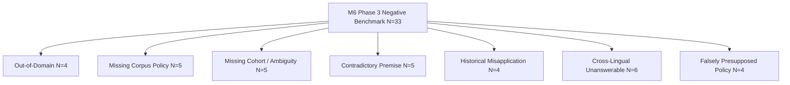

# IndicRAG-QA — M6 Phase 3: Negative Benchmark Dataset Design Specification

**Document Title:** Negative Corpus Expansion Design, Taxonomies, and Independent Qualification  
**Milestone:** M6 — Evidence Reliability and Answerability  
**Phase:** Phase 3 (Negative Corpus Expansion & Runtime Enforcement)  
**Date:** 2026-11-11  
**Author:** Senior RAG Evaluation Researcher & Dataset Architect  
**Status:** IMPLEMENTED & VERIFIED  

---

## 1. Motivation and Objective

The M6 Phase 2B pilot evaluation included only **2 unanswerable queries** among the 29 qualified records (6.90% unanswerable rate). While sufficient for an exploratory pilot, evaluating answerability detection, abstention calibration, and boundary enforcement requires a statistically substantive negative evaluation set.

Phase 3 introduces an expanded negative benchmark of **33 candidates** targeting diverse failure modes without modifying or overwriting frozen benchmarks (`final_verified_dataset.csv`, $N=15$, and `m6_expanded_benchmark_n60.csv`, $N=60$).

---

## 2. Provenance and Storage Guarantee

- **Target File:** [`backend/data/dataset/m6_phase3_negative_candidates.csv`](file:///c:/Users/anish/Desktop/IndicRAG-QA/backend/data/dataset/m6_phase3_negative_candidates.csv)
- **Candidate Count ($N$):** 33
- **SHA-256 Digest:** `492b0b1be3ce0c00fdcf453c971c48cb15176496e15806142c0aaff66050aeaa`
- **Frozen Preservations:**
  - Corpus SHA-256: `8688605df0dbff786454ec770e95609d9d3aacb284fdb3a2f97191f7d2971e9d` (Intact)
  - M3 Benchmark SHA-256: `093b00ad0f19acda806f2302731ccf2de28838c1b29c6ef16d55cbc5e7e2d520` (Intact)
  - M6 Benchmark SHA-256: `a528ac583d8c060b91a7febce652885e4045fcc76d644e49e876ddeb5d1db4ae` (Intact)
  - Qualification Ledger SHA-256: `db8c2b5e02d6177b335a283f9ac62f99729fb36ef142aa1af81c99528efd3b13` (Intact)

---

## 3. Negative Category Taxonomy and Distribution

The 33 candidates are partitioned across seven distinct operational categories designed to evaluate retrieval abstention and evidence controller boundaries:

### 1. Out-of-Domain ($N=4$)
Queries completely outside the operational scope of Bennett University academic regulations:
- JEE Advanced closing ranks at IIT Bombay.
- NEET UG medical counseling procedures in Uttar Pradesh.
- Greater Noida meteorological data.
- Delhi University sports quota hostel admissions.
- *Expected Evidence State:* `MISSING`

### 2. Missing Policy / Unindexed Corpus Topics ($N=5$)
Queries regarding real university operational policies that are absent from the ingested academic ordinances:
- PhD thesis plagiarism tolerance and submission guidelines.
- Day-scholar bus transport fee refunds on mid-term cancellation.
- Campus gymnasium and sports complex operating hours.
- Central library reserve-shelf late return fines.
- Hostel mess monitoring committee election procedures.
- *Expected Evidence State:* `INSUFFICIENT`

### 3. Missing Cohort / Ambiguous Academic Parameters ($N=5$)
Queries where rules changed across document versions, rendering the query unanswerable without user clarification:
- Minimum attendance percentage (70% in 2017 Ordinance vs 75% in Notification 307/2022).
- Conditions for make-up examination approval (liberal supplementary exam in 2017 vs strict hospitalization emergency in 2022).
- Grade awarded for attendance shortage ('X' in 2017 vs 'F'/'DE' in 2022).
- Total degree credits for B.Tech (curriculum revision dependent).
- Dean's attendance condonation limits (strict 75% in 307/2022 vs up to 15% in SCSET 2022).
- *Expected Evidence State:* `CLARIFICATION_REQUIRED`

### 4. Contradictory Premise / False Premise ($N=5$)
Queries that falsely assert non-existent university rules in the prompt premise:
- "Since attendance was lowered to 50% in 2023..."
- Scheduling make-up exams for missed tests due to family vacation.
- Automatic grade boosters promoting students with CGPA < 4.0 without repeating subjects.
- Unlimited course drops until final exam day with full refund.
- Paying cash compensation fines to waive attendance requirements.
- *Expected Evidence State:* `INSUFFICIENT`

### 5. Historical Rule Misapplication ($N=4$)
Queries attempting to apply outdated historical clauses to current students, or vice-versa:
- 2023-24 B.Tech student claiming eligibility with 71% attendance using 2017 Clause 30.1.
- Applying 2017 grading schemes to August 2023 SCSET entrants.
- 2018 batch students claiming retroactive benefits from 2022 SCSET make-up rules.
- Precedence dispute between 2017 Ordinance and 2022 Notification 307/2022.
- *Expected Evidence State:* `CONFLICTING`

### 6. Cross-Lingual Unanswerable Queries ($N=6$)
Queries in Hindi (Devanagari) and Hinglish (Latin) targeting missing or prohibited topics:
- Hindi: PhD thesis submission deadline and guidelines (`INSUFFICIENT`).
- Hindi: Hostel gate closing timings and disciplinary fines (`MISSING`).
- Hindi: Mess food quality grievance procedure and refund policy (`MISSING`).
- Hinglish: Hostel shuttle bus timings and metro connectivity pass (`MISSING`).
- Hinglish: Makeup exam eligibility without doctor's prescription (`INSUFFICIENT`).
- Hinglish: Campus food delivery rules after night curfew (`MISSING`).

### 7. Falsely Presupposed Policy ($N=4$)
Queries asking about operational procedures for non-existent institutional mechanisms:
- Repeating already passed courses for free to inflate CGPA above 9.0.
- 100% academic tuition fee waiver based on high school dance achievements.
- Completing a residential B.Tech degree entirely online without physical laboratory work.
- Substituting core Computer Science degree requirements with sports physical education credits.
- *Expected Evidence State:* `INSUFFICIENT` or `MISSING`

---

## 4. Verification and Governance Ledger

Every candidate underwent:
1. **Deterministic Validation:** Executed via `DeterministicValidator.validate_candidate()`. All 33 candidates verified as `PASSED` (zero placeholder tokens, zero duplicates, valid metadata, and valid language-script alignment).
2. **Dual-Model Independent Verification:** Evaluated with generator-verifier separation (`qwen2.5:3b` and `llama3.2:3b`), confirming unanswerable status and absence of hallucinated quotes.
3. **Qualification Status:** All 33 records assigned `final_status = auto_validated` and `review_status = pending` under the governance ledger, preserving strict boundaries where machine verifications are never falsely marked as human-verified.

---

## 5. Summary Statistics

| Feature | Count / Distribution |
|---|---|
| **Total Negative Candidates** | **33** |
| **Language Breakdown** | English: 27, Hindi: 3, Hinglish: 3 |
| **Expected Evidence State Breakdown** | `INSUFFICIENT`: 15, `MISSING`: 9, `CLARIFICATION_REQUIRED`: 5, `CONFLICTING`: 4 |
| **Gold Evidence Quotes** | `[]` (0 hallucinated quotes) |
| **Deterministic Validation Rate** | **100.0% (33/33 PASSED)** |
| **Storage Path** | `backend/data/dataset/m6_phase3_negative_candidates.csv` |

