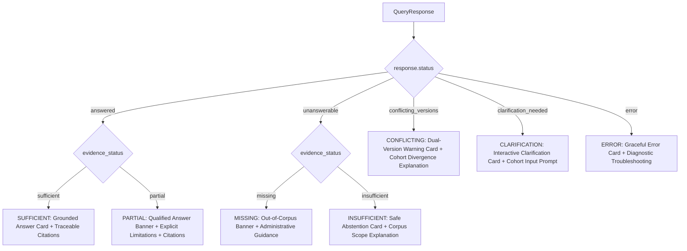

# IndicRAG-QA — M7 Frontend Integration Design Specification

**Document Title:** Frontend Architecture, Evidence Presentation Protocols, and Backend Contract Synchronization  
**Milestone:** M7 — Frontend Integration and Final Research Evaluation  
**Phase:** Phase 1 (Frontend Integration & Evidence Transparency)  
**Date:** 2026-11-11  
**Author:** Senior Full-Stack RAG Engineer & Evidence Reliability Specialist  

---

## 1. Executive Architecture Overview

The IndicRAG-QA frontend is a modern, standalone single-page web interface engineered to communicate directly with the FastAPI REST API (`http://localhost:8000`). It is designed for complete evidentiary transparency, accessibility across desktop and mobile form factors, and rich multilingual rendering (English, Devanagari Hindi, Hinglish, Romanized Hindi).

### Architectural Invariant:
The browser UI acts as a strictly faithful presentation layer. Under no circumstances does the frontend:
1. Re-evaluate or alter the backend `ResponseStatus` or `EvidenceStatus`.
2. Convert safe abstentions (`UNANSWERABLE`), clarification requests (`CLARIFICATION_NEEDED`), or regulatory contradictions (`CONFLICTING_VERSIONS`) into standard answers.
3. Conflate continuous exploratory calibration scores with production certainty.
4. Fabricate missing citation references, page numbers, or clause tags.

---

## 2. Backend REST API Contracts

The frontend binds to three production backend endpoints:

### A. Health Endpoint (`GET /health`)
- **Response Schema:**
  ```json
  {
    "status": "ok",
    "version": "0.1.0",
    "ollama_reachable": true,
    "embedding_model_loaded": true,
    "document_count": 4,
    "passage_count": 142
  }
  ```
- **UI Presentation:** Displays live connection indicator dot, document/passage counts, and health status in header.

### B. Query Endpoint (`POST /query`)
- **Request Schema:**
  ```json
  {
    "query": "string",
    "collection": ["official"] | ["upload"] | ["official", "upload"],
    "response_language": null,
    "top_k": 5,
    "use_reranker": true,
    "use_pdr": true,
    "debug": true
  }
  ```
- **Response Schema:**
  ```json
  {
    "request_id": "uuid-string",
    "status": "answered" | "unanswerable" | "clarification_needed" | "conflicting_versions" | "error",
    "answer": "string or null",
    "language": "en" | "hi" | "hi-Latn" | "hi-en",
    "citations": [
      {
        "document_id": "string",
        "filename": "string",
        "page": 1,
        "passage_id": "uuid-string",
        "quote": "exact passage excerpt",
        "section": "string or null",
        "heading": "string or null",
        "version_info": { "effective_date": "...", "academic_year": "..." },
        "claim_supported": true
      }
    ],
    "evidence_status": "sufficient" | "insufficient" | "conflicting" | "missing" | "partial" | "clarification_required",
    "query_analysis": { ... },
    "retrieval_summary": { ... },
    "latency_ms": 1245.2,
    "model_used": "qwen2.5:3b"
  }
  ```

### C. Document Registry Endpoint (`GET /documents`)
- **Response Schema:** Array of documents with metadata (`document_id`, `filename`, `title`, `source_type`, `page_count`, `ingestion_status`, `academic_year`, `effective_date`, `is_current`).
- **Passage Inspection Endpoint (`GET /documents/{document_id}/passages`):** Retrieves individual indexed passages with chunk indices, headings, and text for modal inspection.

### D. User Upload Endpoint (`POST /uploads`)
- **Payload:** Multipart form data (`file`, `academic_year`, `program_applicability`).
- **Isolation Boundary:** Uploaded documents are tagged with `source_type: "upload"` and indexed into an isolated FAISS/BM25 collection (`get_upload_index()`). They are never included in searches unless the user explicitly activates the "Uploaded" collection chip.

---

## 3. Evidence State Rendering Protocols

The UI provides distinct visual templates, iconography, and color palettes for all six backend evidence states and four response statuses:



### Specific Display Specifications:
1. **SUFFICIENT (`status: answered`, `evidence_status: sufficient`):**
   - High-contrast green emerald badge (`#10b981`).
   - Clean typography with structured markdown formatting.
   - Interactive citation cards showing document title, page number, section, and exact quoted text.
2. **PARTIAL (`status: answered`, `evidence_status: partial`):**
   - Blue/cyan badge (`#38bdf8`).
   - Prominent notification header: `"PARTIAL EVIDENCE — Some sub-questions or parameters could not be fully substantiated from official records."`
3. **INSUFFICIENT (`status: unanswerable`, `evidence_status: insufficient`):**
   - Rose/red badge (`#f43f5e`).
   - Explicit disclaimer that official documents do not contain sufficient evidence to answer authoritatively.
4. **MISSING (`status: unanswerable`, `evidence_status: missing`):**
   - Purple badge (`#a855f7`).
   - Informs the user that the requested policy (e.g. PhD thesis submission, transport refunds, hostel curfew) is not part of the indexed undergraduate academic regulations.
5. **CONFLICTING (`status: conflicting_versions`, `evidence_status: conflicting`):**
   - Amber alert badge (`#f59e0b`).
   - Regulatory discrepancy card outlining conflicting clauses (e.g. 2017 Ordinance §30.1 vs Notification 307/2022). Emphasizes student admission cohort applicability without making arbitrary unilateral choices.
6. **CLARIFICATION_REQUIRED (`status: clarification_needed`, `evidence_status: clarification_required`):**
   - Sky-blue prompt badge (`#0284c7`).
   - Explains missing cohort parameters (e.g., student admission year or degree program) and offers a one-click pre-filled clarification button.

---

## 4. Citation Traceability & Interactive Passage Modal

Every citation rendered in the interface is interactive:
- Displays document filename, official title, page number (`Page X`), section heading, and exact quote excerpt.
- Clicking any citation card expands an in-situ modal drawer displaying the complete passage text from the backend database, ensuring total verifiability.

---

## 5. Accessibility, Responsive Typography & Cross-Lingual Support

- **Multilingual Font Stack:** Utilizes Google's `Inter` font for Latin typography and system-optimized Devanagari fonts (`Noto Sans Devanagari`, `Segoe UI`) with strict line-height spacing (`1.75`) to avoid vowel-sign clipping.
- **Color Contrast:** All text meets WCAG 2.1 AA standards (minimum 4.5:1 contrast against dark background).
- **Multi-Modal Indicators:** Every state uses distinct textual descriptions and icons alongside color badges to ensure full accessibility for color-blind users.

