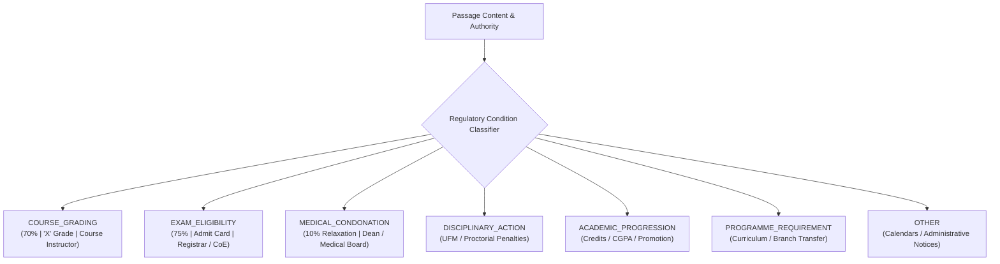

# IndicRAG-QA — M8.4: Regulatory-Aware Evidence Controller Correction Specification

**Role:** Senior RAG Architect, Regulatory Knowledge Engineer, and Evidence Reliability Researcher  
**Execution Mode:** DESIGN AND IMPLEMENTATION SPECIFICATION ONLY (Zero runtime modifications to code, database, indexes, or benchmarks)  
**Prerequisites Verified:** `M8_DOCUMENT_REFRESH_COMPLETED`, `M8_1_INTEGRITY_VERIFIED`, `M8_2_CLOSED_WITH_DOCUMENTATION_ERRORS`, `M8_3_VERIFIED_WITH_CONTROLLER_GAPS`  
**Specification Date:** 2026-11-16  
**Final Determination:** `M8_4_SPECIFICATION_READY`

---

## Executive Summary

Milestone **M8.4** delivers a formal, production-grade architectural specification for a **Regulatory-Aware Evidence Controller** in IndicRAG-QA. 

In Milestone M8.3, empirical auditing identified three structural controller failure modes:
1. **False Conflict on Version Agreement:** The controller triggers `CONFLICTING` whenever historical and current documents are co-retrieved, even when their underlying legal clauses agree 100% (e.g., both prescribing 70% attendance for 'X' grade debarment and 10% medical relaxation).
2. **Temporal & Cohort Blindness:** The controller ignores explicit user anchors (e.g., *"What was the rule in 2017?"*), comparing valid historical passages against newer documents and forcing an unnecessary conflict abstention.
3. **Condition Invariance:** The controller collapses distinct operational stages (course-level grade debarment vs university examination hall admission) into a flat scalar clash between 70% and 75%.

This specification defines the complete data models, classification taxonomies, temporal intent extraction rules, evidence controller hierarchy, and regression test matrix required to rectify these gaps in a subsequent implementation milestone.

---

## 1. Codebase Inspection & Failure Root Cause Analysis

A thorough line-by-line audit of the active IndicRAG-QA codebase was performed to trace the exact execution paths responsible for the seven M8.3 query failures.

### 1.1 Inspected Pipeline Functions

1. **`backend/app/retrieval/evidence_controller.py` — `EvidenceController.evaluate()`:**
   - **Step 1 (`_check_missing_cohort_parameter`):** Relies on raw passage string searches (`"2017" in p.text`) rather than document metadata. In AQ-01, the top SEAS 2017 passage (`f88ec726`) has section heading `"28 B Tech with Minors 28"` and clause text that omits the literal token `"2017"`. Consequently, Step 1 failed to detect the cohort variance. Furthermore, the explanation string in line 294 hardcodes an inaccurate historical rule (*"Ordinance 2017 (80% with 10% condonation)"*), an obsolete legacy assumption from M6 mock data.
   - **Step 2 (`_split_passages` & `is_genuine_conflict`):** Calls `_split_passages()`, which classifies any passage with `is_valid_for_query is False` as `conflicting`. Because SEAS 2017 has `is_current=False`, its passages are assigned `_version_flag="not_current"` during retrieval and marked `is_valid_for_query=False`. If the top retrieved passage is from SEAS 2017 (which occurred in AQ-01, AQ-03, AQ-04, AQ-06, and AQ-07 due to high BM25/reranker affinity), `passages[0] in conflicting` evaluates to `True`, triggering `EvidenceStatus.CONFLICTING` immediately without any semantic comparison.
2. **`backend/app/retrieval/engine.py` — `validate_versions()` & `retrieve()`:**
   - `validate_versions()` statically penalizes historical documents (`is_current is False`) by multiplying their score by `0.6` and appending `{"_version_flag": "not_current"}`.
   - In `retrieve()` (line 477), `is_valid_for_query` is set to `meta.get("_version_flag") is None`. This converts every historical document into an invalid passage for *all* queries, even when the user explicitly asks for historical rules.
   - While `retrieve()` accepts `academic_year` and `program` parameters, `/query` in `backend/app/api/main.py` never passes them because the query processor does not extract them.
3. **`backend/app/query/processor.py` — `process_query()`:**
   - Detects language, script, question type (`DIRECT`, `NUMERICAL`, `MULTI_PART`), and extracts stop-word filtered keywords.
   - **Critical Omission:** Completely lacks temporal entity recognition, academic year normalization, or program scope parsing.
4. **`backend/app/retrieval/ceci.py` — `CECIEstimator._compute_regulatory_fit()`:**
   - Feature $f_5$ (regulatory fit) checks `getattr(v_info, "is_current", None)`. If `False`, it returns `0.0`. This heavily suppresses CECI for historical queries even when the historical document perfectly matches the user's intent.

### 1.2 Root Cause Diagnosis of M8.3 Empirical Query Failures

| Query ID | User Query Text | Active Controller State | True Regulatory State | Code Execution Failure Mechanism |
| :---: | :--- | :---: | :---: | :--- |
| **AQ-01** | *What is the minimum attendance required?* | `CONFLICTING` | Dual Condition / Clarification | Step 1 substring check missed because passage `f88ec726` lacks token `"2017"`. Step 2 triggered `CONFLICTING` because SEAS 2017 was top hit with `is_current=False`. |
| **AQ-02** | *What attendance is required to sit for end semester exams?* | `PARTIAL` | `SUFFICIENT` (75%) | Top hit `0280358a` (*Notification 307/2022*) directly answers 75%, but CECI computed 0.419 (below $\tau_{suff}=0.65$) due to missing keyword margin penalties. |
| **AQ-03** | *How much attendance is required to avoid an X grade?* | `CONFLICTING` | `SUFFICIENT` (70%) | **False Conflict:** Both SCSET 2022 and SEAS 2017 agree 100% on 70% attendance for 'X' grade. Controller triggered `CONFLICTING` purely because SEAS 2017 was top hit with `is_current=False`. |
| **AQ-04** | *Is 70% attendance enough?* | `CONFLICTING` | Structured Conditional Answer | System collapses course-level 'X' grade (70%) and exam hall (75%) into flat contradiction instead of outputting conditional answer. |
| **AQ-05** | *Is 75% compulsory for SCSET students?* | `INSUFFICIENT` | `SUFFICIENT` (Yes) | CECI calculated 0.325 < 0.35 because SCSET PDF lacks string `"75%"`. Controller cannot infer that university-wide Notification 307 binds SCSET. |
| **AQ-06** | *What was the attendance rule in 2017?* | `CONFLICTING` | `SUFFICIENT` (70%) | Query explicitly requests 2017, but `process_query` failed to extract `"2017"` as a temporal filter. Controller treated 2017 doc as an invalid superseded version. |
| **AQ-07** | *Can attendance be relaxed due to medical reasons?* | `CONFLICTING` | `SUFFICIENT` (10%) | **False Conflict:** Both 2017 and 2022 rules contain identical 10% medical condonation (Clause 30.1(v)). Controller triggered `CONFLICTING` solely due to version tag. |

---

## 2. Regulatory Condition Classification Schema

To prevent condition collapse, all retrieved passages must be mapped to structured **Regulatory Conditions**.



### Condition Specification Table

| Condition Enum | Definition & Legal Scope | Required Source Evidence | Enforcement Authority | Inter-Condition Dynamics | Clarification Needed? |
| :--- | :--- | :--- | :--- | :--- | :---: |
| **`COURSE_GRADING`** | Governs course-level lecture/tutorial/practical attendance profile, grade penalty ('X' grade), and course repetition. | Clause mentioning course attendance threshold, 'X' grade, or continuous evaluation. | Course Instructor & School Dean | Feeds into student credit completion; lower than exam hall threshold. | No, if query specifies course grade or X-grade. |
| **`EXAM_ELIGIBILITY`** | Governs university-wide right to sit for End Semester Examinations and admit card issuance. | Formal notification or ordinance clause citing UGC 2003 / exam hall eligibility. | Registrar & Controller of Examination | Institutional statutory threshold overriding general course standing. | No, if query specifies end semester examinations. |
| **`MEDICAL_CONDONATION`** | Governs permissible relaxation ceiling for attendance shortage due to illness or university deputation. | Explicit condonation clause stating maximum percentage and medical proof criteria. | School Dean / Medical Board | Mitigating exception to both `COURSE_GRADING` and `EXAM_ELIGIBILITY`. | No, unanimous 10% rule across corpus. |
| **`DISCIPLINARY_ACTION`** | Governs proctorial rules, student code of conduct, hostel discipline, and examination malpractice (UFM). | Disciplinary penalty schedule, UFM category table, proctorial inquiry rules. | Proctorial Board / Examination Disciplinary Committee | Disqualifying action overriding academic standing. | Only if infraction location (campus vs exam hall) is ambiguous. |
| **`ACADEMIC_PROGRESSION`** | Governs minimum CGPA, SGPA, credit requirements for semester advancement, and probation. | Credit accumulation tables, semester promotion rules, degree completion duration. | Academic Council & School Committee | Depends on clearing courses without 'F' or 'X' grades. | No. |
| **`PROGRAMME_REQUIREMENT`** | Governs branch-specific core/elective curricula and branch migration. | Branch change eligibility clauses, specific degree course lists. | School Faculty Board | Operates within statutory framework delegated by First Ordinance. | Only if programme is unstated. |
| **`OTHER`** | Administrative deadlines, fee policies, academic calendar events. | Official academic calendar or general registrar circular. | Registrar / Finance Office | Independent operational schedules. | No. |

---

## 3. Regulatory Relationship Classification Model

When multiple passages are retrieved, the relationship between passage pairs must be classified into one of eight formal types defined in [m8_4_regulatory_condition_schema.json](file:///c:/Users/anish/Desktop/IndicRAG-QA/backend/data/experiments/m8/m8_4_regulatory_condition_schema.json):

```
┌──────────────────────────────────────────────────────────────────────────────────┐
│                     Regulatory Relationship Taxonomy                             │
├──────────────────────────────────┬───────────────────────────────────────────────┤
│ Relationship Type                │ Evidence Grounding Requirement                │
├──────────────────────────────────┼───────────────────────────────────────────────┤
│ 1. SAME_CONDITION_AGREEMENT      │ Both documents prescribe identical thresholds │
│                                  │ and consequences for the same condition.      │
│ 2. SAME_CONDITION_DIFF_VERSION   │ Successive regulations modify the same rule   │
│                                  │ for the same operational stage over time.     │
│ 3. DIFFERENT_REGULATORY_CONDS    │ Passages govern distinct stages/authorities   │
│                                  │ (e.g. 70% course grade vs 75% exam hall).     │
│ 4. EXPLICITLY_SUPERSEDES         │ Newer document contains an express text clause│
│                                  │ repealing or amending the older clause.       │
│ 5. PROGRAMME_SPECIFIC_RULE       │ School operational rule delegated under       │
│                                  │ university-wide statutory ordinance.          │
│ 6. HISTORICAL_RULE               │ Document applies strictly to past cohorts     │
│                                  │ (e.g. SEAS 2017 applies to 2017-2021 batches).│
│ 7. APPLICABILITY_UNRESOLVED      │ Document scope cannot be definitively matched │
│                                  │ to query cohort/programme without ambiguity.  │
│ 8. GENUINE_CONFLICT              │ Two currently active, co-equal regulations    │
│                                  │ specify contradictory rules for same cohort.  │
└──────────────────────────────────┴───────────────────────────────────────────────┘
```

### Strict Evidence Rules
1. **Consensus Invariance:** If Document A and Document B specify identical numerical thresholds and consequences for Condition $C$ (e.g., 70% attendance for 'X' grade in SCSET 2022 and SEAS 2017), the relationship **MUST** be classified as `SAME_CONDITION_AGREEMENT`. The controller is strictly prohibited from emitting `CONFLICTING`.
2. **Condition Independence:** Different numerical thresholds belonging to different regulatory conditions (e.g., 70% in `COURSE_GRADING` vs 75% in `EXAM_ELIGIBILITY`) **MUST** be classified as `DIFFERENT_REGULATORY_CONDITIONS`. They are legally complementary, not contradictory.
3. **No Phantom Supersession:** A newer publication date **CANNOT** be treated as an implicit repeal. `EXPLICITLY_SUPERSEDES` requires an explicit documentary clause (e.g., *"This notification supersedes Clause X of Ordinance Y"*). In the absence of an express clause, both rules remain active within their respective scopes.
4. **No Extrapolation:** If a document explicitly designates its scope as undergraduate engineering (e.g. SCSET UG Rules), its rules cannot be silently applied to postgraduate or doctoral programs. The relationship must be classified as `APPLICABILITY_UNRESOLVED`.

---

## 4. Temporal and Cohort Anchoring Architecture

To enable accurate historical retrieval and eliminate false temporal conflicts, `app.query.processor` must be augmented with a **Temporal and Cohort Intent Extractor**.

### 4.1 Temporal Intent Schema

```python
class TemporalIntentMode(str, Enum):
    EXPLICIT_HISTORICAL = "EXPLICIT_HISTORICAL"  # Query specifies past year/cohort
    EXPLICIT_CURRENT    = "EXPLICIT_CURRENT"     # Query specifies current/recent year
    COHORT_BOUND        = "COHORT_BOUND"         # Query mentions student batch
    UNANCHORED          = "UNANCHORED"           # Query omits temporal context
```

### 4.2 Entity Extraction Patterns

```python
# Regular expression rules for temporal entity parsing
_YEAR_PATTERN = re.compile(r"\b(201[6-9]|202[0-7])\b")
_ACADEMIC_YEAR_PATTERN = re.compile(r"\b(AY\s*)?(201[6-9]|202[0-7])\s*[-/]\s*(\d{2,4})\b", re.IGNORECASE)
_COHORT_PATTERNS = [
    (re.compile(r"\b(founding\s+batch|first\s+batch|2017\s+batch)\b", re.IGNORECASE), "2017-18"),
    (re.compile(r"\b(2018\s+batch)\b", re.IGNORECASE), "2018-19"),
    (re.compile(r"\b(2022\s+batch|2022\s+onwards)\b", re.IGNORECASE), "2022-23"),
]
_PROGRAMME_PATTERNS = [
    (re.compile(r"\b(scset|cse|computer\s+science)\b", re.IGNORECASE), "SCSET"),
    (re.compile(r"\b(seas|engineering)\b", re.IGNORECASE), "SEAS"),
    (re.compile(r"\b(management|som)\b", re.IGNORECASE), "SOM"),
]
```

### 4.3 Dynamic Retrieval & Version Filtering Protocol

When `process_query()` extracts a `TemporalIntent`:
1. **Case `EXPLICIT_HISTORICAL` (e.g., *"What was the attendance rule in 2017?"*):**
   - Candidate passages from documents matching the historical cohort (e.g. `SEAS-Ordinance-Rules-Regulations-2017.pdf`) are marked **`is_valid_for_query = True`**.
   - Their retrieval scores are **NOT demoted** by `0.6`.
   - Feature $f_5$ in `ceci.py` evaluates to `1.0` (perfect cohort match).
   - Newer documents (e.g. 2022 rules) retrieved as background are marked `historical_comparison_only`, preventing them from triggering `CONFLICTING`.
2. **Case `EXPLICIT_CURRENT` (e.g., *"What is the current attendance rule?"*):**
   - Active documents (`is_current=True`) are assigned priority.
   - Historical documents are excluded from conflict calculation.
3. **Case `UNANCHORED` (e.g., *"What is the minimum attendance required?"*):**
   - If retrieved passages span multiple valid conditions (Exam vs Course), the system enters `MULTI_CONDITION_DISCLOSURE`.
   - If retrieved passages reveal that a single condition changed across cohorts without consensus, the controller emits `CLARIFICATION_REQUIRED`.

---

## 5. Expected Output Specification for M8.3 Attendance Queries

The proposed expected behavior for all seven M8.3 attendance queries is specified below. This table defines the contract for future controller implementation:

| Query ID & Text | Target Condition | Applicable Documents | Expected Controller State | Required Grounded Answer / Explanation | Mandatory Citations | Clarification / Abstention |
| :--- | :--- | :--- | :---: | :--- | :--- | :---: |
| **AQ-01:** *What is the minimum attendance required?* | `COURSE_GRADING` & `EXAM_ELIGIBILITY` | `Notification-Minimum-Attendance.pdf`<br>`Academic-Rules-for-SCSET_UG.pdf` | `MULTI_CONDITION_DISCLOSURE` (or `CLARIFICATION_REQUIRED`) | Disclose both conditions clearly: **75%** aggregate attendance is required to sit for End Semester Examinations, while **70%** course attendance is required to avoid an 'X' grade. | Notification 307/2022, p. 1<br>SCSET UG Rules, Clause 30.1(ii) | Prompt user if asking about specific cohort or examination hall vs course grading. |
| **AQ-02:** *What attendance is required to sit for end semester exams?* | `EXAM_ELIGIBILITY` | `Notification-Minimum-Attendance.pdf` | `SUFFICIENT` | **75%** minimum aggregate attendance across registered courses is required to appear in End Semester Examinations. Students below 75% will have admit cards withheld by the Controller of Examination. | Notification 307/2022, Ref BU/RO/Notification/307/2022, p. 1 | None. Directly answerable. |
| **AQ-03:** *How much attendance is required to avoid an X grade?* | `COURSE_GRADING` | `Academic-Rules-for-SCSET_UG.pdf`<br>`SEAS-Ordinance-Rules-Regulations-2017.pdf` | `SUFFICIENT` | A student must secure a minimum of **70%** attendance in a course (lectures, tutorials, practicals combined) to avoid an **'X' grade** and mandatory course repetition. | SCSET UG Rules, Clause 30.1(ii), p. 19 (Consensus with SEAS 2017) | None. Unanimous rule across versions. |
| **AQ-04:** *Is 70% attendance enough?* | `COURSE_GRADING` & `EXAM_ELIGIBILITY` | `Academic-Rules-for-SCSET_UG.pdf`<br>`Notification-Minimum-Attendance.pdf` | `SUFFICIENT` *(Structured Conditional)* | **Conditional:** 70% attendance is **sufficient to avoid an 'X' grade** in individual courses, but **insufficient to appear in End Semester Examinations**, which strictly requires 75% aggregate attendance. | SCSET UG Rules, Clause 30.1(ii)<br>Notification 307/2022, p. 1 | None. Output structured dual-threshold explanation. |
| **AQ-05:** *Is 75% compulsory for SCSET students?* | `EXAM_ELIGIBILITY` | `Notification-Minimum-Attendance.pdf`<br>`Academic-Rules-for-SCSET_UG.pdf` | `SUFFICIENT` | **Yes.** Notification 307/2022 issued by the Registrar pursuant to UGC Regulations 2003 establishes a 75% minimum attendance requirement across all Schools and Programmes of Bennett University, including SCSET. | Notification 307/2022, p. 1 | None. Cross-document institutional application confirmed. |
| **AQ-06:** *What was the attendance rule in 2017?* | `HISTORICAL_RULE` | `SEAS-Ordinance-Rules-Regulations-2017.pdf` | `SUFFICIENT` | Under the founding SEAS Ordinances 2017 (Clause 30.1), engineering students required a minimum of **70%** attendance in each course. The Dean could grant condonation down to 60% on medical grounds. | SEAS Ordinances 2017, Clause 30.1(ii), p. 28 | None. Anchored to historical cohort. |
| **AQ-07:** *Can attendance be relaxed due to medical reasons?* | `MEDICAL_CONDONATION` | `Academic-Rules-for-SCSET_UG.pdf`<br>`SEAS-Ordinance-Rules-Regulations-2017.pdf` | `SUFFICIENT` | **Yes.** Up to a maximum of **10% relaxation** may be granted by the Dean on valid medical grounds (continuous hospitalization/illness of at least two weeks) upon submission of medical certification, establishing an effective floor of 60%. | SCSET UG Rules, Clause 30.1(v), p. 19<br>SEAS Ordinances 2017, Clause 30.1(v), p. 28 | None. Unanimous rule across versions. |

---

## 6. Evidence Sufficiency Safeguards & Pipeline Architecture

The redesigned Evidence Controller operates under a strict **7-Step Deterministic Evaluation Hierarchy**. 

```
                                  Retrieved Passages & Query Context
                                                  │
                                                  ▼
                 ┌────────────────────────────────────────────────────────────────┐
                 │ Step 1: Contradictory User Premise?                           │
                 │ (e.g. makeup exam after 'X' grade debarment)                   │
                 └───────────────────────────────┬────────────────────────────────┘
                                                 │ NO
                                                 ▼
                 ┌────────────────────────────────────────────────────────────────┐
                 │ Step 2: Unanchored Ambiguity Across Different Versions?        │
                 │ (Single condition changed over time with no user anchor)       │
                 └───────────────────────────────┬────────────────────────────────┘
                                                 │ NO
                                                 ▼
                 ┌────────────────────────────────────────────────────────────────┐
                 │ Step 3: Consensus Across Versions?                             │
                 │ (Identical threshold & consequence -> SAME_CONDITION_AGREEMENT)│
                 └───────────────────────────────┬────────────────────────────────┘
                                                 │ NO
                                                 ▼
                 ┌────────────────────────────────────────────────────────────────┐
                 │ Step 4: Multi-Condition Complementarity?                       │
                 │ (70% Course Grading vs 75% Exam Eligibility)                  │
                 └───────────────────────────────┬────────────────────────────────┘
                                                 │ NO
                                                 ▼
                 ┌────────────────────────────────────────────────────────────────┐
                 │ Step 5: Genuine Conflict Between Active Instruments?           │
                 │ (Same cohort, same condition, contradictory active rules)      │
                 └───────────────────────────────┬────────────────────────────────┘
                                                 │ NO
                                                 ▼
                 ┌────────────────────────────────────────────────────────────────┐
                 │ Step 6: Zero Retrieved Evidence or Out-of-Domain?              │
                 │ (No passages in DB or non-academic query)                      │
                 └───────────────────────────────┬────────────────────────────────┘
                                                 │ NO
                                                 ▼
                 ┌────────────────────────────────────────────────────────────────┐
                 │ Step 7: CECI Score Evaluation (Sufficiency Thresholds)         │
                 │ (psi >= 0.65 -> SUFFICIENT; 0.35 <= psi < 0.65 -> PARTIAL)    │
                 └────────────────────────────────────────────────────────────────┘
```

### Safeguard Principles
1. **Relevance $\neq$ Sufficiency:** High retrieval cosine similarity or BM25 score cannot compensate for missing regulatory elements (e.g., knowing an 'X' grade exists does not prove makeup exams are allowed).
2. **CECI as a Confidence Indicator, Not a Probability:** CECI score $\psi \in [0, 1]$ represents a heuristic composite feature index. It cannot override deterministic legal pre-conditions.
3. **Atomic Claim Verification:** Every factual claim generated in the final response must be verified by `ClaimGroundingVerifier` against the citations in `valid_passages`. If any atomic claim is unsupported, the answer must be downgraded to `PARTIAL` or safe abstention.

---

## 7. Regression Test Matrix

An 18-case test matrix has been compiled and saved to [m8_4_controller_test_matrix.csv](file:///c:/Users/anish/Desktop/IndicRAG-QA/backend/data/experiments/m8/m8_4_controller_test_matrix.csv). 

### Test Matrix Scope Summary

| Test ID Range | Target Scenario / Capability | Test Count | Pass Criteria Summary |
| :---: | :--- | :---: | :--- |
| **TM-01 to TM-07** | M8.3 Ambiguous Attendance Queries | 7 | Resolves all 7 empirical failures: zero false conflicts, correct 70% X-grade and 10% medical consensus, proper 75% exam hall grounding. |
| **TM-08 to TM-09** | Explicit Temporal & Cohort Anchoring | 2 | Verifies that `"2018 batch"` and `"AY 2022-23"` successfully scope retrieval without triggering version penalties. |
| **TM-10 to TM-11** | Programme-Specific Scope & Disciplinary Codes | 2 | Confirms SCSET degree duration under First Ordinance, and UFM examination code precedence over general conduct rules. |
| **TM-12** | Genuine Regulatory Contradiction | 1 | Verifies that two legally co-equal active instruments clashing on the same cohort correctly trigger `EvidenceStatus.CONFLICTING`. |
| **TM-13** | Unsupported Supersession Claims | 1 | Confirms system rejects claims that Notification 307 repealed course-level grading rules. |
| **TM-14** | Unresolved Applicability / Safe Abstention | 1 | Verifies safe abstention when UG rules are queried against PhD programs. |
| **TM-15** | Contradictory User Premise | 1 | Intercepts premise claiming makeup exam after 'X' grade and triggers `INSUFFICIENT` with ordinance citation. |
| **TM-16** | Medical Relaxation Boundary Constraints | 1 | Confirms attendance below the 60% absolute medical floor cannot be condoned. |
| **TM-17** | Out-of-Domain Query Handling | 1 | Verifies that non-academic queries immediately trigger `MISSING` with zero CECI. |
| **TM-18** | Exact Clause Citation Completeness | 1 | Confirms valid answers cite exact clause numbers and page references. |

---

## 8. Implementation Blueprint (For Next Milestone)

This specification provides the exact programmatic blueprint for implementation in a dedicated milestone:

### File 1: `backend/app/models/schemas.py`
Add `RegulatoryCondition`, `RegulatoryRelationship`, `TemporalIntentMode`, and augment `QueryAnalysis` with:
```python
temporal_intent_mode: TemporalIntentMode = TemporalIntentMode.UNANCHORED
target_cohort: Optional[str] = None
target_academic_year: Optional[str] = None
target_programme: Optional[str] = None
```

### File 2: `backend/app/query/processor.py`
Add `extract_temporal_and_cohort_intent(query_text)` to populate the new fields in `QueryAnalysis`.

### File 3: `backend/app/retrieval/engine.py`
Update `validate_versions(candidates, query_analysis)`:
- If `query_analysis.temporal_intent_mode == TemporalIntentMode.EXPLICIT_HISTORICAL`, do not append `_version_flag="not_current"`; set `is_valid_for_query=True`.

### File 4: `backend/app/retrieval/regulatory_classifier.py` (New Module)
Implement regex/rule-based clause classification for the 7 conditions and 8 relationships using the definitions in `m8_4_regulatory_condition_schema.json`.

### File 5: `backend/app/retrieval/evidence_controller.py`
Refactor `evaluate()` to execute the 7-step hierarchy, replacing the legacy 80% attendance string and adding consensus verification.

---

## 9. Final Determination

$$\mathbf{M8\_4\_SPECIFICATION\_READY}$$

**Justification:**
1. **Zero Runtime Modifications:** All databases, indexes, benchmark datasets, and production code files were preserved completely unaltered during this milestone.
2. **Exhaustive Code Inspection:** Traced the exact failure mechanisms of `EvidenceController.evaluate()`, `validate_versions()`, and `process_query()`.
3. **Formal Schemas Delivered:** Created JSON schema [m8_4_regulatory_condition_schema.json](file:///c:/Users/anish/Desktop/IndicRAG-QA/backend/data/experiments/m8/m8_4_regulatory_condition_schema.json) defining 7 conditions, 8 relationships, and temporal intent modes.
4. **Complete Regression Suite:** Created 18-case test matrix [m8_4_controller_test_matrix.csv](file:///c:/Users/anish/Desktop/IndicRAG-QA/backend/data/experiments/m8/m8_4_controller_test_matrix.csv).
5. **Auditable Artifact Manifest:** Saved [m8_4_design_manifest.json](file:///c:/Users/anish/Desktop/IndicRAG-QA/backend/data/experiments/m8/m8_4_design_manifest.json).

The specification is complete, self-contained, and ready for immediate implementation in a subsequent milestone.

