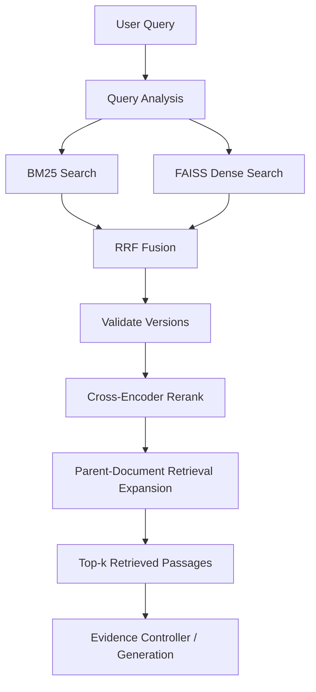
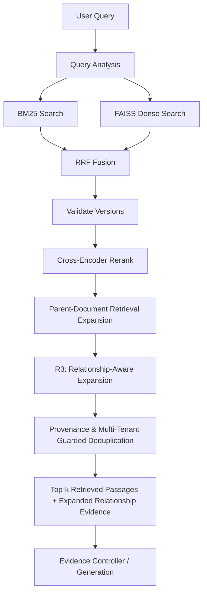

# IndicRAG-QA — R3 Existing Architecture Audit: Relationship-Aware Retrieval

**Document Version:** 1.0  
**Phase:** R3 — Generic Relationship-Aware Retrieval  
**Date:** 2026-11-19  
**Status:** COMPLETE  

---

## 1. Executive Summary

IndicRAG-QA was previously enhanced across two major reliability milestones:
- **R1:** Native-safe PDF extraction and structural table reconstruction (`pdf_extractor.py`, `table_extractor.py`) using `pypdf` + custom deterministic layout analyzers.
- **R2 / R2.1:** SQLite-backed `document_relationships` store, bidirectional table row/event/date modeling, regulatory exception modeling, and conversational feedback repair (`feedback_repair.py`).

However, retrieval in `engine.py` currently operates purely via BM25 + FAISS dense bi-encoder + RRF fusion + Cross-Encoder reranking + Parent-Document Retrieval (PDR). Crucially:
1. **Retrieval does not traverse relationships:** When a user queries a rule, an exam event, or a clause, the engine retrieves isolated passages. If the condition, prerequisite, exception, or exact calendar schedule is stored in a linked row or subclause, the retrieval engine does not expand or retrieve those linked relationships during candidate retrieval.
2. **Ingestion relationship extraction is currently partial:** While structural table relationships are automatically extracted on ingestion via `extract_table_relationships_from_db`, generic regulatory/hierarchical relationships (clauses, subclauses, exceptions, conditions, dates) were only deterministically extracted for pre-selected official documents. Uploaded documents or arbitrary PDFs do not have a generic relationship extractor parsing their clauses, rules, and conditions.

Phase R3 builds a generic, document-independent relationship-aware retrieval layer that connects relevant evidence across passages, tables, clauses, events, conditions, exceptions, and multiple documents for both preloaded official documents and user uploads without breaking M10 production retrieval or multi-tenant isolation.

---

## 2. Subsystem Audit & Classification

| # | Subsystem | Key Files | Status | Description & Gap Analysis | Action in R3 |
|---|---|---|---|---|---|
| **1** | **PDF Extraction & Table Reconstruction** | `backend/app/ingestion/pdf_extractor.py` `backend/app/ingestion/table_extractor.py` | `Reuse unchanged` | R1 native-safe extractor extracts text, detects grid/pipe/whitespace tables, reconstructs markdown, and populates `table_cells`. High fidelity across multi-page tables. | Reuse unchanged. |
| **2** | **SQLite Relationship Store & Schemas** | `backend/app/retrieval/relationship_store.py` `backend/app/schemas.py` | `Extend` | `document_relationships` table stores subject, predicate, object, source passage, page, row, table, confidence, user_id. Has queries for events, exceptions, applicability. Gap: No generic relationship-expanded candidate retrieval method; ingestion lacks automated generic text hierarchy extraction. | Extend `relationship_store.py` with generic document relationship extraction and candidate expansion methods. |
| **3** | **Document & Passage Metadata** | `backend/app/models.py` `backend/app/schemas.py` `backend/app/core/database.py` | `Reuse unchanged` | `documents`, `passages`, `table_cells` tables store full provenance: `document_id`, `passage_id`, `page_number`, `parent_passage_id`, `source_type`, `user_id`. | Reuse unchanged. All expanded evidence must retain this metadata. |
| **4** | **BM25 & FAISS Retrieval** | `backend/app/retrieval/engine.py` (`RetrieverIndex`) | `Reuse unchanged` | Separate `official` and `upload` FAISS indexes with `IndexFlatIP` and BM25 rankers. Multi-tenant filtering by `user_id` on uploads. Fast and robust. | Reuse unchanged. Primary retrieval remains BM25 + FAISS. |
| **5** | **Hybrid Retrieval & RRF** | `backend/app/retrieval/engine.py` (`_rrf_fuse`) | `Reuse unchanged` | Reciprocal Rank Fusion ($k=60$) combines BM25 and dense results seamlessly. | Reuse unchanged. |
| **6** | **Reranking & CECI Evidence Controller** | `backend/app/retrieval/engine.py` `backend/app/retrieval/ceci.py` `backend/app/retrieval/evidence_controller.py` | `Reuse unchanged` | Production reranker (`cross-encoder/ms-marco-MiniLM-L-6-v2`) and CECI controller enforce grounded claims with thresholds ($\tau_{\text{suff}}=0.65, \tau_{\text{insuff}}=0.35$). Default `rerank_strategy="production"`. | Retain `production` reranker unchanged. Do not enable experimental E6b. |
| **7** | **Parent-Document Retrieval (PDR)** | `backend/app/retrieval/engine.py` (`expand_to_parents`) | `Reuse unchanged` | Replaces or supplements child chunk with parent passage to provide broader context window. | Retain as step prior to or alongside relationship expansion. |
| **8** | **Conversation & Feedback Repair** | `backend/app/conversation_store.py` `backend/app/feedback_repair.py` | `Reuse unchanged` | R2.1 context-aware repair handles user challenges, Devanagari Hindi, and calendar date reconciliation. | Reuse unchanged. Verify that R3 relationship retrieval complements feedback repair. |
| **9** | **User-Uploaded vs Official Separation** | `backend/app/retrieval/engine.py` `backend/app/ingestion/pipeline.py` | `Extend` | Official documents are indexed in `official` index; uploaded files are indexed in `upload` index with `user_id` tags. Gap: Ensure relationship expansion on uploaded documents strictly enforces `user_id`. | Extend relationship queries to enforce `(r.user_id = ? OR (r.user_id IS NULL AND source_type = 'official'))`. |
| **10** | **Tenant Isolation & Provenance Enforcement** | `backend/app/core/database.py` `backend/app/retrieval/engine.py` | `Extend` | Provenance tracks `document_id`, `passage_id`, `page_number`. Gap: Relationship edges between documents must not leak across distinct user tenants. | Guard multi-tenant boundaries during graph expansion. |

---

## 3. Data Structures & Schema Inspection

### Database Schema in `backend/data/db/indicrag.db`

1. **`documents`**:
   - `document_id` (TEXT, PK)
   - `filename`, `source_type`, `file_hash`, `title`, `description`
   - `page_count` (INTEGER)
   - `metadata` (JSON TEXT, contains `user_id`, `academic_year`, `effective_date`)
   - `ingestion_status`, `error_message`, `created_at`, `updated_at`

2. **`passages`**:
   - `passage_id` (TEXT, PK)
   - `document_id` (TEXT, FK)
   - `text` (TEXT)
   - `page_number` (INTEGER)
   - `section`, `heading` (TEXT)
   - `parent_passage_id` (TEXT)
   - `is_parent` (BOOLEAN)
   - `chunk_index`, `total_chunks` (INTEGER)
   - `metadata` (JSON TEXT, contains `user_id`, `table_ref`, etc.)

3. **`document_tables` & `table_cells`**:
   - `table_id`, `document_id`, `page_number`, `headers`, `num_rows`, `num_cols`, `structured_text`, `raw_markdown`
   - `cell_id`, `table_id`, `row_index`, `col_index`, `header`, `cell_value`, `original_text`, `confidence`

4. **`document_relationships`**:
   - `relationship_id` (TEXT, PK)
   - `subject_id` (TEXT), `predicate` (TEXT), `object_value` (TEXT)
   - `source_document_id` (TEXT), `source_passage_id` (TEXT), `source_page` (INTEGER), `source_table_id` (TEXT), `source_row_id` (INTEGER)
   - `confidence` (REAL), `temporal_anchor` (TEXT), `cohort_scope` (TEXT), `programme_scope` (TEXT)
   - `extraction_method` (TEXT), `user_id` (TEXT), `created_at` (TEXT)

---

## 4. Current vs Proposed Retrieval Flow

### Current Flow (M10 Production):

### Proposed Flow (R3 Relationship-Aware):

---

## 5. Identified Architectural Gaps & Required Actions

1. **Generic Document Ingestion Relationship Extractor:**
   - Ingestion currently calls `extract_table_relationships_from_db` on upload, which extracts table rows, dates, and headers.
   - However, structural text relationships (`RULE_HAS_CLAUSE`, `CLAUSE_HAS_SUBCLAUSE`, `RULE_HAS_EXCEPTION`, `RULE_HAS_THRESHOLD`, `RULE_APPLIES_TO_PROGRAM`, `EVENT_HAS_DATE`) are not extracted from generic PDF text passages on ingestion.
   - *Remedy:* Implement `extract_generic_relationships_from_doc(doc_id, user_id=None)` in `relationship_store.py` and call it during `ingest_pdf()` for all documents.

2. **Relationship Expansion in `engine.py`:**
   - Currently, `engine.py` retrieves isolated chunks. If chunk $A$ mentions "Clause 30.1: Attendance Rules", and chunk $B$ on the next page contains the medical leave exception, standard BM25/dense might miss chunk $B$ unless the query explicitly contains words like "medical certificate".
   - *Remedy:* Add `expand_relationships(top_candidates, user_id, max_expanded=5)` in `engine.py` after Cross-Encoder reranking / PDR. For each top retrieved passage, fetch related passages linked via `RULE_HAS_EXCEPTION`, `CLAUSE_HAS_SUBCLAUSE`, `EVENT_HAS_DATE`, etc., preserving full citation provenance.

3. **Multi-Tenant Scoping:**
   - All relationship queries must enforce strict tenant isolation:
     `WHERE (user_id = ? OR (user_id IS NULL AND source_type = 'official'))`.
   - Prevent cross-user relationship traversal.
