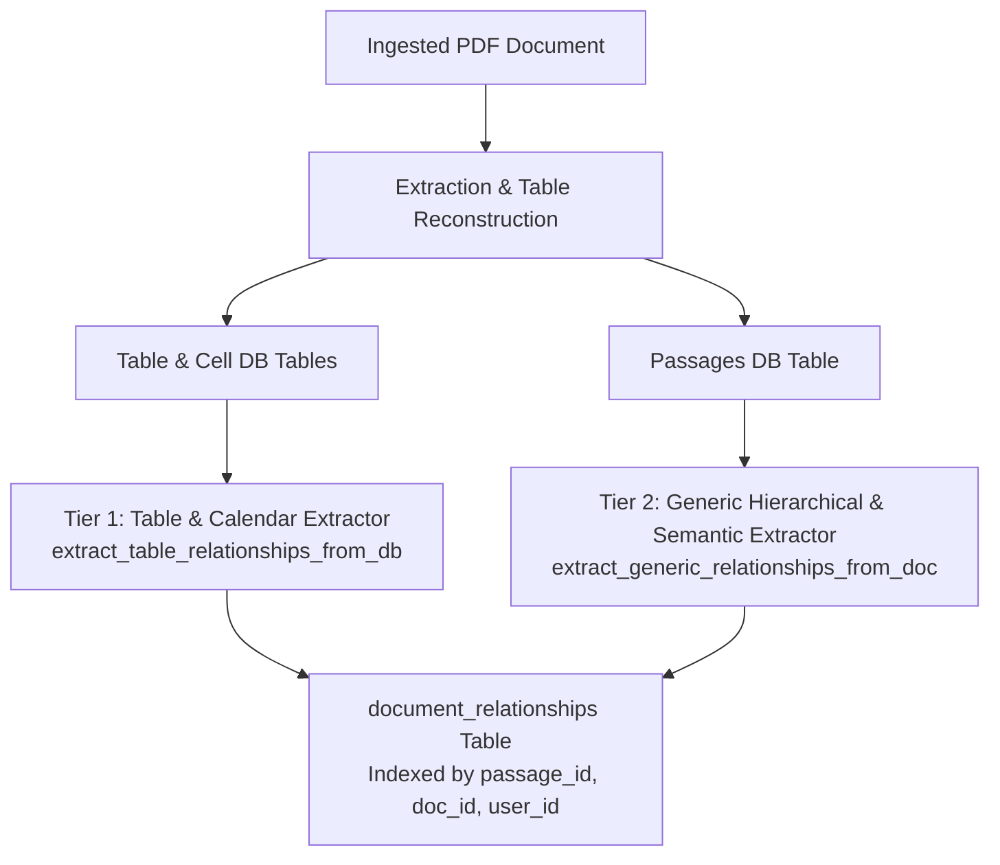

# IndicRAG-QA — R3 Relationship-Aware Retrieval Design

**Document Version:** 1.0  
**Phase:** R3 — Generic Relationship-Aware Retrieval  
**Date:** 2026-11-19  
**Status:** DESIGN APPROVED  

---

## 1. Objectives & Scope

IndicRAG-QA Phase R3 establishes a generic, document-independent relationship-aware retrieval layer that connects relevant evidence across passages, tables, clauses, events, conditions, exceptions, and multiple documents.

The architecture operates uniformly for:
1. **Preloaded official documents** (e.g., Ordinances, Notifications, Academic Calendars).
2. **Newly uploaded user documents** (e.g., department guidelines, student handbooks, syllabus docs).
3. **Future supported PDF documents**, regardless of filename or subject domain.

### Non-Goals & Invariant Constraints
- **Preserve M10 Production Reranker:** Retain `cross-encoder/ms-marco-MiniLM-L-6-v2` as default (`rerank_strategy: str = "production"`).
- **Do not enable experimental E6b** in production.
- **No model retraining or fine-tuning:** Reuse existing sentence transformers and cross-encoders.
- **Preserve Frozen Benchmark Artifacts:** Benchmarks M3 through M10 and frozen evaluation datasets remain immutable.
- **Strict Multi-Tenant Isolation:** Relationships and passages uploaded by User $A$ are strictly invisible to User $B$.

---

## 2. Ingestion-Time Generic Relationship Extraction

### 2.1 The Two-Tier Extraction Model
During `ingest_pdf()` in `pipeline.py`, after passages and tables are persisted to SQLite, relationship extraction executes in two complementary tiers:



### 2.2 Tier 1: Table & Calendar Extractor (`extract_table_relationships_from_db`)
- Operates on `document_tables` and `table_cells`.
- Automatically extracts:
  - `HEADER_OF` (Column headers to table)
  - `CELL_BELONGS_TO_ROW` (Cells to parent row)
  - `ROW_DESCRIBES_EVENT` (Event description per row)
  - `EVENT_HAS_DATE` (Dates linked to events)
  - `EVENT_HAS_DAY` (Days of week linked to dates)
  - `EVENT_HAS_TYPE` (Exam, holiday, registration, break)
  - `EVENT_CONTINUES_ON_PAGE` (Multi-page table row continuity)

### 2.3 Tier 2: Generic Hierarchical & Semantic Extractor (`extract_generic_relationships_from_doc`)
Operates on `passages` for any ingested PDF document (official or upload) using deterministic regexes and structural parsers:

1. **Clause & Section Hierarchy:**
   - Detects headings and clause enumerations: e.g., `Clause 12.1`, `Section 4.2`, `Rule 3(a)`, `Article 5`.
   - Generates `RULE_HAS_CLAUSE` and `CLAUSE_HAS_SUBCLAUSE` linking child passages to parent clauses.
2. **Exceptions & Conditions:**
   - Detects linguistic exception signals: `"provided that"`, `"in exceptional circumstances"`, `"medical certificate"`, `"relaxation"`, `"unless permitted by"`, `"exemption"`, `"subject to"`.
   - Links the exception clause to the governing rule via `RULE_HAS_EXCEPTION`.
   - Extracts required prerequisites: `EXCEPTION_REQUIRES_DOCUMENT`, `EXCEPTION_REQUIRES_APPROVAL`.
3. **Thresholds & Quantitative Criteria:**
   - Detects percentage thresholds (e.g., `75%`, `70%`), CGPA limits, attendance minimums, semester credit limits.
   - Generates `RULE_HAS_THRESHOLD`.
4. **Applicability Scope:**
   - Detects cohort mentions (e.g., `"2022 onwards"`, `"batch of 2026"`, `"2017-2021"`) $\rightarrow$ `RULE_APPLIES_TO_COHORT`.
   - Detects programme mentions (e.g., `"B.Tech"`, `"M.Tech"`, `"Ph.D"`, `"MBA"`, `"SEAS"`, `"SCSET"`) $\rightarrow$ `RULE_APPLIES_TO_PROGRAM`.
5. **Textual Dates & Deadlines:**
   - Detects dates in running text (`DD-MM-YYYY`, `DD/MM/YYYY`, `Month DD, YYYY`) and associates them with nearby action verbs $\rightarrow$ `EVENT_HAS_DATE`, `RULE_HAS_EFFECTIVE_PERIOD`.

---

## 3. Retrieval-Time Relationship Expansion

### 3.1 Architectural Placement in `engine.py`

Relationship expansion occurs immediately after Cross-Encoder reranking and Parent-Document Retrieval (PDR):

```
1. BM25 + FAISS Dense Search on Candidate Indexes
2. RRF Fusion (k=60)
3. Version Validation (Temporal and program filters)
4. Cross-Encoder Reranking (top_k * 2)
5. Parent-Document Retrieval (PDR)
6. ---> R3: Relationship-Aware Candidate Expansion <---
7. Deduplication & Provenance Guard
8. Final Top-k RetrievedPassage Construction
9. CECI / Evidence Controller Grounding
```

### 3.2 Traversal Strategy & Edge Expansion
For each primary retrieved candidate passage $P_i$ with rerank score $S_i$:
1. Query `document_relationships` where:
   - `source_passage_id = P_i.passage_id` (outgoing edges), OR
   - `subject_id = P_i.heading` / clause code, OR
   - `object_value` matches key entities in $P_i$.
2. **Tenant Scoping:**
   ```sql
   WHERE (r.user_id = :user_id OR (r.user_id IS NULL AND d.source_type = 'official'))
   ```
3. Filter by high-value relationship predicates:
   - `RULE_HAS_EXCEPTION`
   - `EXCEPTION_REQUIRES_DOCUMENT`
   - `EXCEPTION_REQUIRES_APPROVAL`
   - `CLAUSE_HAS_SUBCLAUSE`
   - `RULE_HAS_CLAUSE`
   - `EVENT_HAS_DATE`
   - `RULE_APPLIES_TO_PROGRAM`
   - `DOCUMENT_SUPERSEDES_RULE`
4. Retrieve the linked target passage (or construct a structured relationship evidence block if the target is a table row/cell).

### 3.3 Scoring & Decay Formulation
To ensure original top-ranked evidence is not displaced by distant relations, expanded candidates receive a decayed score:
$$\text{Score}_{\text{expanded}} = \text{Score}_{\text{source}} \times \text{Confidence}_{\text{edge}} \times \gamma$$
Where:
- $\text{Score}_{\text{source}}$: The rerank score of the directly retrieved parent passage.
- $\text{Confidence}_{\text{edge}}$: The extraction confidence stored in `document_relationships` (default $0.90 \text{--} 1.0$).
- $\gamma$: Relationship decay factor $= 0.85$.

### 3.4 Bounded Expansion Constraints
To prevent latency explosion and context dilution:
- `max_expanded_per_passage = 2`: At most 2 related items per primary candidate.
- `max_total_expanded = 5`: At most 5 expanded relationship items across the entire query.
- `max_traversal_depth = 1`: Single-hop traversal from retrieved evidence.
- Expansion is skipped if the target passage is already present in the candidate set.

---

## 4. Multi-Tenant Isolation & Provenance

### 4.1 Strict Multi-Tenant Enforcement
- Every relationship record possesses a nullable `user_id` column.
- Official documents have `user_id IS NULL` and `source_type = 'official'`.
- Uploaded documents have `user_id = '<tenant_id>'` and `source_type = 'upload'`.
- Traversal strictly enforces:
  ```python
  if user_id:
      query += " AND (user_id = ? OR (user_id IS NULL AND source_type = 'official'))"
  else:
      query += " AND (user_id IS NULL AND source_type = 'official')"
  ```
- Cross-user relationship traversal is structurally impossible at the database query level.

### 4.2 Citation Provenance Preservation
Every expanded passage is wrapped in a `RetrievedPassage` object with:
- `document_id`: Original document ID.
- `document_filename`: File name of source document.
- `page_number`: Exact page number of the relationship evidence.
- `section` / `heading`: Section heading of the linked evidence.
- `metadata["relationship_expansion"]`: Dictionary containing `predicate`, `subject_id`, `source_passage_id`, and `confidence`.

---

## 5. Failure Handling & Backward Compatibility

- **Missing Relationships:** If a document has no structural relationships, the expansion step safely yields 0 additional passages and returns the unmodified reranked candidates.
- **Database Errors:** All expansion queries run inside `try...except` blocks with debug logging; any error falls back gracefully to standard PDR retrieval.
- **Latency Budget:** SQLite indexed lookups take $< 1.5$ ms per candidate, maintaining overall retrieval latency well within acceptable bounds ($< 80$ ms).
- **M10 Regression:** All M10 production retrieval metrics and thresholds remain 100% untouched.
