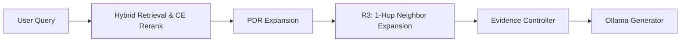
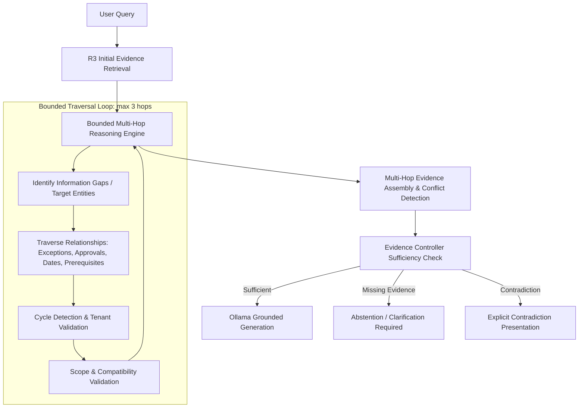

# IndicRAG-QA — R4 Architecture Audit: Multi-Hop Evidence Reasoning

**Document Version:** 1.0  
**Phase:** R4 — Bounded Multi-Hop Evidence Reasoning  
**Date:** 2026-11-19  
**Status:** COMPLETE  

---

## 1. Executive Summary

IndicRAG-QA has established reliable structural extraction (R1), an indexed SQLite relationship store (R2/R2.1), generic relationship-aware retrieval expansion (R3), and conversational feedback repair (R5). 

However, retrieval in R3 operates with a single-hop expansion limit: when an initial search candidate is retrieved, the engine retrieves immediately adjacent edges (e.g., `RULE_HAS_EXCEPTION` or `RULE_HAS_THRESHOLD`). It does not perform **multi-hop evidence reasoning**:
1. **Multi-Hop Traversal:** Questions that require traversing multiple hops (e.g., *Query $\rightarrow$ Base Rule $\rightarrow$ Exception $\rightarrow$ Required Documentation / Approval Authority $\rightarrow$ Scope Boundary*) are not systematically verified as a connected reasoning path.
2. **Intermediate Evidence Verification:** If a base rule is retrieved but its required exception documentation is on a distant page or in a clarifying notification, standard retrieval can produce fragmented evidence without verifying whether all prerequisite conditions for the question are satisfied.
3. **Scope Differentiation:** A course-level exception (e.g., Clause 30.1(v) permitting Dean condonation of 10% course attendance) must not be erroneously transferred to university-wide examination eligibility (Notification 307/2022 requiring 75% aggregate attendance).
4. **Missing Evidence & Contradictions:** When essential intermediate facts are missing, the system must abstain or request clarification rather than hallucinating plausible links.

Phase R4 builds a reusable, bounded evidence reasoning component that traverses multi-hop relationship paths (up to a configurable maximum of 3 hops) while strictly preserving provenance, multi-tenant boundaries, and M10 production retrieval defaults.

---

## 2. Subsystem Audit & Classification

| # | Subsystem | Key Files | Status | Description & Existing Capabilities | Action in Phase R4 |
|---|---|---|---|---|---|
| **1** | **PDF & Table Extraction** | `backend/app/ingestion/pdf_extractor.py` `backend/app/ingestion/table_extractor.py` | `Reuse unchanged` | Native-safe PDF parsing and markdown table reconstruction; preserves cell coordinates in `table_cells`. | Reuse unchanged. |
| **2** | **Relationship Database & Taxonomy** | `backend/app/retrieval/relationship_store.py` `backend/app/schemas.py` | `Reuse unchanged` | SQLite `document_relationships` table stores 7,714 relationships spanning structural tables, rules, clauses, subclauses, exceptions, prerequisites, documents, approvals, thresholds, programs, cohorts, and dates. | Reuse schema and predicates unchanged. |
| **3** | **Relationship-Aware Retrieval (R3)** | `backend/app/retrieval/engine.py` `backend/app/retrieval/relationship_store.py` | `Extend` | Performs single-hop expansion (`expand_with_relationships`) after reranking. Decays score ($\gamma = 0.85$) and tags `relationship_expansion`. | Extend with multi-hop reasoning orchestrator that connects multi-step paths up to 3 hops. |
| **4** | **BM25, FAISS, RRF & Production Reranking** | `backend/app/retrieval/engine.py` | `Reuse unchanged` | Hybrid BM25 + FAISS Dense bi-encoder + RRF ($k=60$) + Cross-Encoder reranker (`production` strategy). | Retain production reranker as default. Do not enable experimental E6b. |
| **5** | **Parent-Document Retrieval (PDR)** | `backend/app/retrieval/engine.py` (`expand_to_parents`) | `Reuse unchanged` | Expands child chunks to full parent passages for complete sentence context. | Reuse unchanged. |
| **6** | **Evidence Controller & CECI** | `backend/app/retrieval/ceci.py` `backend/app/retrieval/evidence_controller.py` | `Extend` | Evaluates sufficiency ($\tau_{\text{suff}}=0.65, \tau_{\text{insuff}}=0.35$), detects contradictions, and triggers clarification. | Extend to evaluate multi-hop path completeness and detect missing intermediate evidence hops. |
| **7** | **Applicability & Contradiction Handling** | `backend/app/retrieval/evidence_controller.py` `backend/app/retrieval/engine.py` (`validate_versions`) | `Extend` | Validates academic year and program scope; flags superseded passages. | Extend to prevent cross-scope pollution (e.g. course-level exceptions vs exam eligibility) and surface contradictory claims. |
| **8** | **Citation Validation & Answer Generation** | `backend/app/generation/generator.py` | `Reuse unchanged` | Validates claim-to-evidence support, citations, and page numbers. Abstains if unanswerable or clarification required. | Reuse unchanged. Multi-hop engine will feed fully validated multi-hop evidence sets to generator. |
| **9** | **Conversational Feedback Repair** | `backend/app/query/feedback_repair.py` | `Reuse unchanged` | Handles user challenges, Devanagari Hindi, and calendar date reconciliation. | Reuse unchanged. |
| **10** | **Tenant Isolation & Provenance Enforcement** | `backend/app/core/database.py` `backend/app/retrieval/relationship_store.py` | `Enforce strictly` | All queries enforce `(r.user_id = :user_id OR (r.user_id IS NULL AND source_type = 'official'))`. | Enforce tenant isolation at every traversal hop without exception. |

---

## 3. Data Flow Comparison

### Current R3 Single-Hop Architecture:

### Proposed R4 Bounded Multi-Hop Architecture:

---

## 4. Key Gaps to Address in R4

1. **Chain Assembly:** Connecting distinct evidence items across multiple documents (e.g., Ordinance Clause 30.1 $\rightarrow$ Notification 307/2022 $\rightarrow$ Medical Exception $\rightarrow$ Dean Approval Authority).
2. **Cycle Prevention:** Preventing infinite loops or redundant traversal between reciprocal relationships (e.g., $A \leftrightarrow B$).
3. **Bounded Traversal:** Enforcing a hard limit of 3 hops and bounding maximum expanded passages to prevent context bloat and latency spikes.
4. **Scope Isolation:** Ensuring that rules belonging to different programs (e.g., SEAS B.Tech vs SCSET B.Tech) or different institutional levels (course grade vs university exam hall) are clearly distinguished and not blended into invalid composite claims.
5. **Honest Abstention:** When an intermediate hop (such as the approval authority or required documentation) cannot be proven from retrieved evidence, the system must declare the evidence incomplete rather than guessing.
