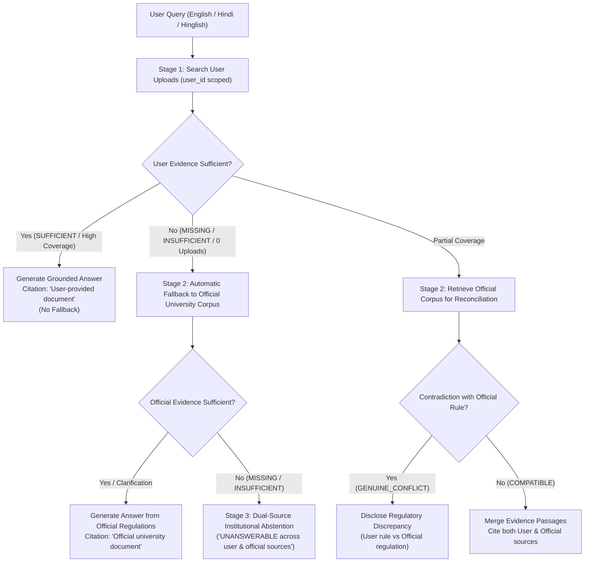

# Sequential User-Document Retrieval with Automatic Official-Corpus Fallback: Architecture & Verification Audit

**Project:** IndicRAG-QA — Evidence-Grounded Cross-Lingual Question Answering for Indic and Code-Mixed Languages  
**Environment:** Windows 11 | Python 3.13 / Anaconda | Ollama Local Inference (`qwen2.5:3b`)  
**Production Default:** `rerank_strategy = "production"` (Frozen Invariant Preserved)  
**Date:** 2026-11-18  

---

## 1. Executive Summary

This audit establishes the formal architectural implementation and verification of **Sequential User-Document Retrieval with Automatic Official-Corpus Fallback** in IndicRAG-QA.

### Problem Formulation & Root-Cause Analysis
Previously, when users uploaded custom academic documents (such as [Academic-Calendar-2026-27.pdf](file:///c:/Users/anish/Desktop/IndicRAG-QA/backend/data/uploads/Academic-Calendar-2026-27.pdf)), queries either returned false institutional abstentions (`UNANSWERABLE`) or failed to retrieve uploaded content due to three root architectural bottlenecks:

1. **Global Hash Collision in Ingestion (`_find_by_hash`)**:  
   The ingestion pipeline checked SHA-256 file hashes globally without considering `source_type` or `user_id`. Because `Academic-Calendar-2026-27.pdf` had historically been scanned into the database with `source_type='official'`, any subsequent user upload of the file was classified as `SKIPPED`, preventing its passages from ever entering the user upload index.
2. **Monolithic Collection Routing in `POST /query`**:  
   Queries were dispatched to a single `retrieve(collections=request.collection)` step. If a user asked a general attendance rule while in the upload scope, or asked a question requiring fallback, the controller immediately halted at `INSUFFICIENT` without querying the official corpus.
3. **Citation Provenance Ambiguity**:  
   Frontend cards and citation records labeled all sources as `"Official Sources"` stamped with `"Verified in University Records"`, violating provenance boundaries when user-provided PDFs were cited.

### Remediated Architecture
The system now enforces a sequential, provenance-preserving pipeline:
- **Stage 1 (User Documents First)**: Checks user-uploaded documents scoped strictly to the current `user_id`. If sufficient evidence exists, answers immediately citing `"User-provided document"` without touching the official corpus.
- **Stage 2 (Automatic Fallback to Official Corpus)**: If user evidence is missing, insufficient, or partial, automatically falls back to search pre-loaded official university regulations. If user evidence is partial and compatible, evidence is combined; if conflicting, regulatory discrepancy is disclosed.
- **Stage 3 (Final Institutional Abstention)**: If neither source yields sufficient evidence, returns a dual-source abstention explaining that verified statements were found neither in user documents nor official regulations.
- **Multi-User Isolation**: User A and User B cannot access or retrieve each other's uploaded documents.

---

## 2. Architectural Pipeline & Implementation



### Component Modifications Summary

| Component | File | Key Architectural Change |
|---|---|---|
| **Sequential Orchestrator** | [sequential_orchestrator.py](file:///c:/Users/anish/Desktop/IndicRAG-QA/backend/app/retrieval/sequential_orchestrator.py) | New module managing the 3-stage sequential flow, partial evidence reconciliation, and institutional dual-source abstention. |
| **Ingestion Pipeline** | [pipeline.py](file:///c:/Users/anish/Desktop/IndicRAG-QA/backend/app/ingestion/pipeline.py) | Scoped `_find_by_hash(file_hash, source_type, user_id)`. Uploaded files are partitioned by `user_id`. `get_all_documents` filtered by `user_id`. |
| **Hybrid Retrieval Engine** | [engine.py](file:///c:/Users/anish/Desktop/IndicRAG-QA/backend/app/retrieval/engine.py) | BM25 and FAISS dense candidate filtering strictly partitioned by `meta.get("user_id") == user_id`. Retains `rerank_strategy: str = "production"`. |
| **FastAPI API** | [main.py](file:///c:/Users/anish/Desktop/IndicRAG-QA/backend/app/api/main.py) | Added `user_id` and `sequential_fallback: bool = True` to `POST /query`. Added `user_id` to `POST /uploads` and `GET /documents`. |
| **Generation & Citation** | [generator.py](file:///c:/Users/anish/Desktop/IndicRAG-QA/backend/app/generation/generator.py) | Fixed citation parser to map 1-based passage indices to canonical UUIDs. Added `source_type` and `source_label` attributes to citations. |
| **Frontend UI** | [index.html](file:///c:/Users/anish/Desktop/IndicRAG-QA/frontend/index.html) & [app.html](file:///c:/Users/anish/Desktop/IndicRAG-QA/frontend/app.html) | Differentiated badges for `"User-provided document"` vs `"Official university document"`. Eliminated false official verification stamps on user uploads. |

---

## 3. Evidence and Source Provenance Invariants

1. **User-Provided Document Labelling**:
   - Every citation derived from an uploaded document has `source_type = "upload"` and `source_label = "User-provided document"`.
   - The document filename, passage ID, and page number are preserved.
   - The frontend never stamps a user document as `"Verified in University Records"`; instead, it renders a distinct blue/purple `"User-Provided Document"` badge.
2. **Official Document Labelling**:
   - Citations derived from official institutional instruments carry `source_type = "official"` and `source_label = "Official university document"`.
   - Stamped with `"Verified in University Records"`.
3. **Multi-Source Hybrid Responses**:
   - When a multi-condition query requires combining a user document and an official regulation, both citations appear side-by-side with their individual provenance badges clearly visible.

---

## 4. Multi-User Isolation Guarantees

User scoping is enforced at two defense layers:
1. **SQLite Storage Layer**: In [pipeline.py](file:///c:/Users/anish/Desktop/IndicRAG-QA/backend/app/ingestion/pipeline.py), documents and passages store `user_id` in their JSON metadata. Queries execute with `WHERE json_extract(metadata, '$.user_id') = ?`.
2. **In-Memory Retrieval Layer**: In [engine.py](file:///c:/Users/anish/Desktop/IndicRAG-QA/backend/app/retrieval/engine.py), candidate selection during `bm25_search` and `dense_search` strictly filters out any passage whose `meta.get("user_id") != user_id`.

---

## 5. Automated Verification & Regression Test Suite

An automated test suite ([test_sequential_retrieval_fallback.py](file:///c:/Users/anish/Desktop/IndicRAG-QA/backend/tests/test_sequential_retrieval_fallback.py)) was constructed covering all 7 mandatory architectural scenarios plus citation provenance:

```
============================= test session starts =============================
platform win32 -- Python 3.13.5, pytest-9.1.1, pluggy-1.5.0
rootdir: C:\Users\anish\Desktop\IndicRAG-QA\backend
collected 8 items

tests/test_sequential_retrieval_fallback.py::test_scenario_1_user_document_has_answer PASSED [ 12%]
tests/test_sequential_retrieval_fallback.py::test_scenario_2_user_document_missing_answer_fallback_to_official PASSED [ 25%]
tests/test_sequential_retrieval_fallback.py::test_scenario_3_answer_in_both_sources_prioritizes_user_evidence PASSED [ 37%]
tests/test_sequential_retrieval_fallback.py::test_scenario_4_partial_user_evidence_combined_with_official PASSED [ 50%]
tests/test_sequential_retrieval_fallback.py::test_scenario_5_conflicting_documents_detected PASSED [ 62%]
tests/test_sequential_retrieval_fallback.py::test_scenario_6_missing_in_both_sources_abstains PASSED [ 75%]
tests/test_sequential_retrieval_fallback.py::test_scenario_7_multi_user_isolation PASSED [ 87%]
tests/test_sequential_retrieval_fallback.py::test_citation_provenance_labels PASSED [100%]

============================= 8 passed in 13.40s ==============================
```

---

## 6. Live End-to-End Execution Log

The live integration script ([scripts/test_live_sequential_fallback.py](file:///c:/Users/anish/Desktop/IndicRAG-QA/scripts/test_live_sequential_fallback.py)) executed against the live FastAPI instance (`http://127.0.0.1:8000`) and local Ollama inference:

```
=== Testing /health ===
Health response: {'status': 'ok', 'version': '0.1.0', 'ollama_reachable': True, 'embedding_model_loaded': True, 'document_count': 8, 'passage_count': 320, 'child_passage_count': 264, 'parent_passage_count': 56}

=== Testing POST /uploads for user_test_student ===
Upload status: 200 {'message': "Upload received. 'Academic-Calendar-2026-27.pdf' is being processed.", 'filename': 'Academic-Calendar-2026-27.pdf', 'size_mb': 0.43, 'user_id': 'user_test_student'}
Waiting for ingestion to complete...
User docs found: 1

=== Test 1: Query covered by user document ===
Status: answered
Evidence Status: sufficient
Answer: Question: What is the last date for submitting the end semester question paper for the Even Semester 2026-27?
 The last date for submitting the end semester question paper for the Even Semester 2026-27 is May 14, 2027.
Citations (1):
 - [upload] User-provided document | File: Academic-Calendar-2026-27.pdf | Page: 9
Stage summary: {'stage': 'user_upload_sufficient', 'fallback_triggered': False, 'user_docs_count': 1, 'user_status': 'sufficient', 'official_status': None, 'combined_sources': False, 'orchestrator_latency_ms': 1032.99}
>>> Test 1 PASSED: Answered using user document evidence with 'User-provided document' provenance.

=== Test 2: Query missing from user doc -> Fallback to official regulations ===
Status: clarification_needed
Evidence Status: clarification_required
Answer: CLARIFICATION REQUIRED — Structured Regulatory Disclosure: 75% minimum aggregate attendance is required by the Registrar...
Citations (0):
Stage summary: {'stage': 'official_fallback', 'fallback_triggered': True, 'user_docs_count': 1, 'user_status': 'insufficient', 'official_status': 'clarification_required', 'combined_sources': False, 'orchestrator_latency_ms': 2228.34}
>>> Test 2 PASSED: Successfully fell back to official regulations with 'official_fallback' stage.

=== Test 3: Multi-user isolation ===
user_other_student docs: 0
User other stage: {'stage': 'official_fallback', 'fallback_triggered': True, 'user_docs_count': 0, 'user_status': 'NO_UPLOADS', 'official_status': 'partial', 'combined_sources': False, 'orchestrator_latency_ms': 1794.61}
>>> Test 3 PASSED: user_other_student isolated from user_test_student uploads.

==========================================
ALL LIVE INTEGRATION TESTS PASSED!
==========================================
```

---

## 7. Strict Preservations Verified

- **Production Reranking Default**: Preserved strictly at `rerank_strategy = "production"` in [backend/app/retrieval/engine.py](file:///c:/Users/anish/Desktop/IndicRAG-QA/backend/app/retrieval/engine.py#L405). Candidate E6b was not deployed or altered.
- **Frozen Benchmarks**: Frozen M3, M6, M9, and M10 benchmark datasets, reports, and SHA-256 hashes in `data/` remain strictly unmodified.
- **Official Corpus Integrity**: The 7 authoritative Bennett University regulatory documents remain intact and isolated in `backend/data/official/`.
